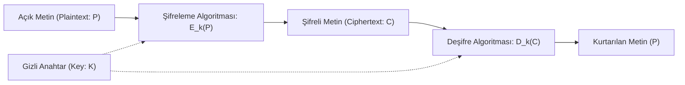

Modern bilgi güvenliği mimarilerinin omurgasını oluşturan kriptoloji, verinin yalnızca yetkisiz gözlerden saklanmasını değil; verinin değiştirilmediğinin (bütünlük), kaynağının doğruluğunun (kimlik doğrulama) ve eylemin inkar edilemezliğinin garanti altına alınmasını sağlayan disiplinler arası bir bilimdir.

---

## 1. Teorik Sezgi & Matematik

Kriptoloji şemsiyesi temelde iki zıt ancak birbirini sürekli besleyen alana ayrılır:
* **Kriptografi (Şifre Yazımı):** Açık metni ($P \in \mathcal{M}$), bir anahtar ($K \in \mathcal{K}$) kullanarak şifreli metne ($C \in \mathcal{C}$) dönüştüren algoritmalar tasarlama disiplini.
* **Kriptanaliz (Şifre Çözümü):** Anahtara sahip olmadan veya şifreleme sistemindeki kusurlardan yararlanarak $C$'den $P$'yi elde etme ya da anahtarı türetme bilimi.

### Kerckhoffs Prensibi ve Güvenlik Seviyesi

1883 yılında Auguste Kerckhoffs tarafından ortaya konan ve modern kriptografinin anayasası kabul edilen prensip şudur:

> *"Bir kriptografik sistemin güvenliği, algoritmanın gizliliğine değil; yalnızca anahtarın ($K$) gizliliğine dayanmalıdır."*

Sistemin algoritması düşman tarafından tamamen bilinse dahi sistem matematiksel olarak kırılamaz olmalıdır. *"Gizlilik yoluyla güvenlik"* (*Security through obscurity*) anlayışı bir yanılsamadır; açık standartlar küresel denetime ve kriptanaliz testlerine tabi tutuldukça olgunlaşır.



### Shannon'ın Kusursuz Gizlilik Tanımı ve One-Time Pad (OTP)

Claude Shannon, 1949 yılında enformasyon teorisini kriptografiye uygulayarak **Kusursuz Gizlilik** (*Perfect Secrecy*) koşulunu matematiksel olarak tanımlamıştır.

Bir şifreleme sisteminin kusursuz gizli sayılabilmesi için, şifreli metin ($C$) gözlemlendiğinde açık metnin ($P$) ortaya çıkma olasılığı, açık metnin önceki olasılığına özdeş olmalıdır:

$$P(\mathcal{M} = m \mid \mathcal{C} = c) = P(\mathcal{M} = m)$$

Başka bir deyişle; şifreli metin, saldırgana açık metin hakkında sıfır bit ek bilgi sağlamalıdır.

**One-Time Pad (Vernam Şifresi):**
1. Mesaj ($m$) ve anahtar ($k$) eşit uzunlukta bit dizileridir ($|m| = |k|$).
2. Şifreleme XOR işlemidir: $c = m \oplus k$
3. Deşifreleme aynı anahtarla XOR işlemidir: $m = c \oplus k$
4. **Kritik Kural:** Anahtar tamamen rastgele (CSPRNG) üretilmeli ve asla ikinci kez kullanılmamalıdır.

Shannon Teoremi kanıtlamıştır ki; kusursuz gizlilik için anahtar uzayı mesaj uzayından küçük olamaz ($|\mathcal{K}| \ge |\mathcal{M}|$). Bu nedenle OTP pratik internet iletişiminde (terabaytlarca veri) anahtar dağıtım problemi yüzünden tek başına kullanılamaz; modern kriptografi bu teorik sınırı hesaplama zorluğu varsayımlarına (DLP, Factorization, Lattices) dayalı **hesaplamalı güvenlik** (*Computational Security*) ile aşar.

---

## 2. Gerçek Hayat Mimarisi

* **Kusursuz Gizlilik Uygulamaları:** Soğuk Savaş döneminde Washington-Moskova arasındaki kırmızı telefon hattı fiziksel olarak kuryelerle taşınan tek kullanımlık delikli bantlarla (OTP) korunuyordu. Günümüzde ise QKD (Kuantum Anahtar Dağıtımı) tabanlı askeri hatlarda anlık simetrik anahtar yenilemede OTP ilkeleri kullanılır.
* **Modern Hesaplamalı Güvenlik:** TLS 1.3, Signal Protokolü ve SSH gibi endüstri standartları Kerckhoffs ilkesine tam bağlıdır. Algoritmalar (AES, ChaCha20, X25519) halka açıktır; oturum güvenliği efemeral (geçici) oturum anahtarlarının korunmasına emanettir.

---

## 3. Uygulamalı Kod Örneği: Python ile One-Time Pad ve Anahtar Tekrarı Analizi

Aşağıdaki Python betiği; kusursuz gizliliğe sahip One-Time Pad mekanizmasını ve bir anahtar iki kez kullanıldığında ($k_1 = k_2$) ortaya çıkan "Two-Time Pad" zaafının açık metinleri nasıl ifşa ettiğini modeller.

```python
import os

def otp_encrypt(plaintext: bytes, key: bytes) -> bytes:
    """Tek kullanımlık anahtar ile XOR şifreleme."""
    if len(plaintext) != len(key):
        raise ValueError("Anahtar ve metin boyutları eşit olmalıdır!")
    return bytes(p ^ k for p, k in zip(plaintext, key))

def otp_decrypt(ciphertext: bytes, key: bytes) -> bytes:
    """Şifreli metni deşifreleme."""
    return otp_encrypt(ciphertext, key)

# 1. Kusursuz Gizlilik Testi
msg1 = b"SALDIRI_PLANI_A"
key = os.urandom(len(msg1))  # Kriptografik rastgele anahtar

c1 = otp_encrypt(msg1, key)
decrypted = otp_decrypt(c1, key)
assert decrypted == msg1
print(f"[+] Başarılı OTP Şifreleme: {c1.hex()}")

# 2. İki Kez Kullanım Zaafı (Two-Time Pad Felaketi)
# Eğer aynı anahtarla ikinci bir mesaj şifrelenirse:
msg2 = b"GERI_CEKILIN_XX"
c2 = otp_encrypt(msg2, key)

# Saldırgan anahtarı bilmese bile: C1 ^ C2 = (M1 ^ K) ^ (M2 ^ K) = M1 ^ M2
xor_texts = bytes(a ^ b for a, b in zip(c1, c2))
print(f"[!] C1 ^ C2 sonucu (Anahtar tamamen yok oldu): {xor_texts.hex()}")

# Saldırgan M1'deki bir kelimeyi tahmin ederse (Crib Dragging):
crib = b"SALDIRI"
derived_fragment = bytes(x ^ c for x, c in zip(xor_texts[:len(crib)], crib))
print(f"[!] Saldırganın açık metin tahminiyle açığa çıkan M2 parçası: {derived_fragment.decode('utf-8', errors='ignore')}")
```

---

## 4. Güvenlik & Kriptanaliz Notu

> [!WARNING]
> **One-Time Pad'de Anahtar Tekrarı (Key Reuse) = Anında İfşa**
> Bir akış şifreleyicide veya OTP'de anahtar/keystream bir kez daha kullanılırsa; saldırgan iki şifreli metni birbiriyle XOR'layarak anahtarı denklemden tamamen düşürür ($C_1 \oplus C_2 = M_1 \oplus M_2$). Doğal dil istatistikleri ve *crib dragging* teknikleriyle her iki mesaj dakikalar içinde okunabilir hale gelir. WEP protokolünün (802.11b) çöküşünün başlıca nedeni 24-bit IV tekrarı yüzünden aynı RC4 anahtar akışının üretilmesiydi.
