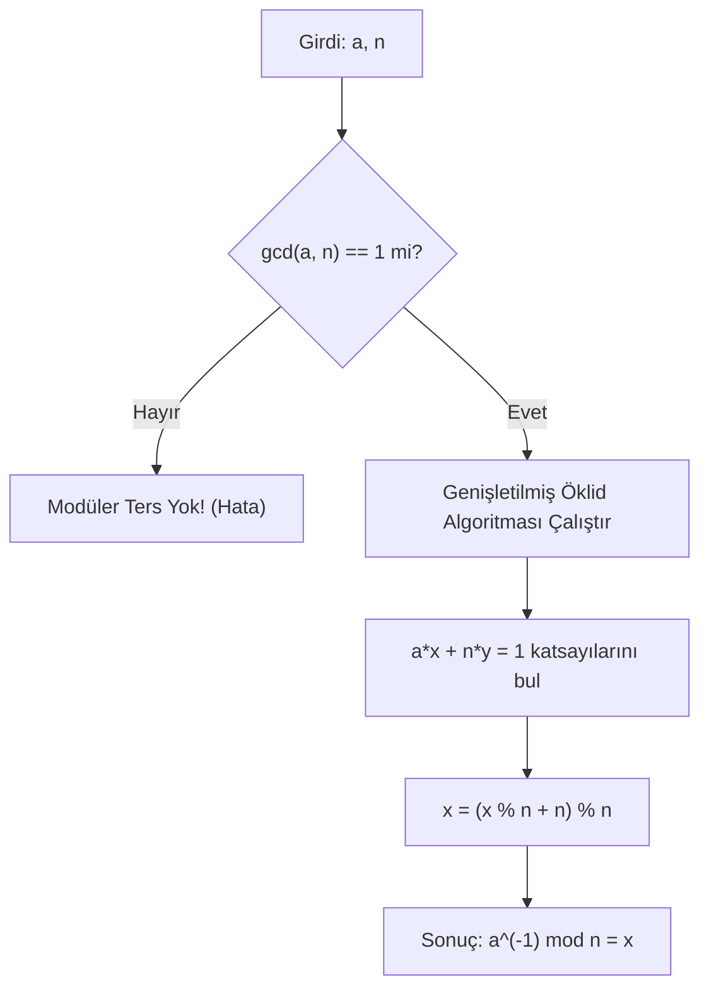

Kriptografi, sonsuz reel sayılar kümesinde değil; sınırlı, döngüsel ve cebirsel olarak kapalı sonlu kümelerde çalışır. Bu cebirsel evrenin kalbi **Modüler Aritmetik**tir ("Saat Aritmetiği").

---

## 1. Teorik Sezgi & Matematik

### Modüler Denklik

İki tam sayı $a$ ve $b$, pozitif bir tam sayı olan $n$'ye bölündüklerinde aynı kalanı veriyorsa, bu sayılar $n$ modülüne göre birbirine denktir:

$$a \equiv b \pmod{n} \iff n \mid (a - b)$$

Burada $\mathbb{Z}_n = \{0, 1, 2, \dots, n-1\}$ kümesi, $n$ elemanlı kalan sınıflarını temsil eder.

### Modüler İşlemler ve Özellikleri

1. **Toplama:** $(a + b) \pmod{n} = [(a \pmod{n}) + (b \pmod{n})] \pmod{n}$
2. **Çarpma:** $(a \cdot b) \pmod{n} = [(a \pmod{n}) \cdot (b \pmod{n})] \pmod{n}$
3. **Üs Alma:** $a^b \pmod{n}$ (Kriptografide *Binary Exponentiation* veya *Square-and-Multiply* ile $O(\log b)$ karmaşıklıkta hesaplanır).

### Modüler Bölme ve Çarpımsal Ters (Modular Inverse)

Reel sayılarda bölme işlemi $a / b = a \cdot b^{-1}$ şeklinde çarpımsal ters ile ifade edilir. Modüler dünyada bölme işlemi ancak $b$'nin $n$ modundaki **çarpımsal tersi** ($x$) ile mümkündür:

$$b \cdot x \equiv 1 \pmod{n}$$

Burada $x \equiv b^{-1} \pmod{n}$ olarak yazılır.

> **Kritik Koşul:** $b$'nin $n$ modülünde bir tersinin bulunabilmesi için, $b$ ve $n$'nin **aralarında asal** olması şarttır:
> $$\gcd(b, n) = 1$$

### Genişletilmiş Öklid Algoritması (Extended Euclidean Algorithm)

Bézout Özdeşliği der ki; herhangi iki sıfırdan farklı tam sayı $a$ ve $b$ için öyle $x$ ve $y$ tam sayıları vardır ki:

$$a \cdot x + b \cdot y = \gcd(a, b)$$

Eğer $\gcd(a, n) = 1$ ise:
$$a \cdot x + n \cdot y = 1 \implies a \cdot x \equiv 1 \pmod{n}$$
Dolayısıyla Bézout katsayısı olan $x$, doğrudan $a$'nın $n$ modundaki çarpımsal tersidir.



---

## 2. Gerçek Hayat Mimarisi

* **RSA Anahtar Üretimi:** Gizli anahtar üssü $d$, açık üs $e$'nin $\phi(n)$ modundaki tersidir: $d \equiv e^{-1} \pmod{\phi(n)}$. Genişletilmiş Öklid algoritması olmadan RSA anahtarı türetilemez.
* **Eliptik Eğri Aritmetiği:** Nokta toplama ve eğim hesaplamalarında ($m = \frac{y_2 - y_1}{x_2 - x_1} \pmod{p}$) paydada kalan değerin mod $p$'deki tersi alınır.

---

## 3. Uygulamalı Kod Örneği: Python ve Go ile Modüler Ters Hesaplayıcı

### Python İmplementasyonu

```python
def extended_gcd(a: int, b: int):
    """Bézout katsayılarını hesaplar: a*x + b*y = gcd(a, b)"""
    if a == 0:
        return b, 0, 1
    gcd, x1, y1 = extended_gcd(b % a, a)
    x = y1 - (b // a) * x1
    y = x1
    return gcd, x, y

def mod_inverse(a: int, m: int) -> int:
    """a sayısının m modundaki çarpımsal tersini döndürür."""
    gcd, x, _ = extended_gcd(a, m)
    if gcd != 1:
        raise ValueError(f"{a} ve {m} aralarında asal değil! Modüler ters mevcut değil.")
    return (x % m + m) % m

# Test: 7 * x = 1 (mod 26) -> x = 15
inv = mod_inverse(7, 26)
print(f"[+] 7'nin mod 26'daki tersi: {inv}")
assert (7 * inv) % 26 == 1
```

### Go İmplementasyonu (Büyük Sayılarla - `math/big`)

```go
package main

import (
	"fmt"
	"math/big"
)

func main() {
	// a = 65537 (Standart RSA açık üssü e)
	a := big.NewInt(65537)
	// m = Örnek Euler Totient değeri phi(n)
	m, _ := new(big.Int).SetString("10221173679883580436411707086884693899", 10)

	// ModInverse: z = a^(-1) mod m
	inverse := new(big.Int).ModInverse(a, m)

	if inverse == nil {
		fmt.Println("[-] Modüler ters bulunamadı!")
		return
	}

	fmt.Println("[+] Modüler ters:", inverse.String())

	// Doğrulama: (a * inverse) % m == 1
	prod := new(big.Int).Mul(a, inverse)
	rem := new(big.Int).Mod(prod, m)
	fmt.Println("[+] Doğrulama kalan (1 olmalı):", rem.String())
}
```

---

## 4. Güvenlik & Kriptanaliz Notu

> [!CAUTION]
> **Modüler Üs Almada Zamanlama Yan Kanalı (Timing Side-Channel)**
> Standart *Square-and-Multiply* algoritmasında üssün her biti tek tek taranır. Eğer bit `1` ise hem kare alma (*square*) hem de çarpma (*multiply*) yapılır; bit `0` ise sadece kare alınır. Çarpma ek işlem süresi gerektirdiğinden, işlemci çevrimlerini izleyen bir saldırgan yürütme süresinden gizli anahtarın ($d$) bit dizilimini çıkarabilir. 
> Güvenli kriptografik kütüphaneler bu nedenle **Sabit Zamanlı (Constant-Time)** algoritma sürümlerini (örneğin *Montgomery Ladder*) kullanır.

