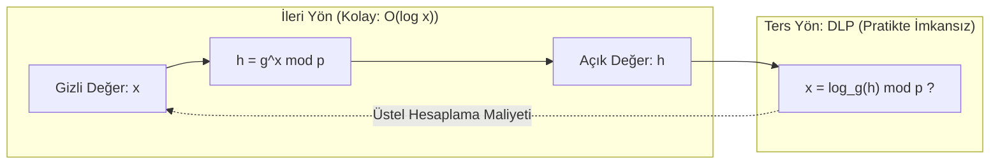

Açık anahtarlı kriptografinin temel dayanağı, tek yönlü fonksiyonlar (*one-way functions*) ve matematiksel olarak hesaplanması kolay ancak tersi pratikte imkansız kabul edilen sert problemlerdir. Bu problemlerin merkezinde asal sayılar ve çarpanlara ayırma yer alır.

---

## 1. Teorik Sezgi & Matematik

### Fermat'nın Küçük Teoremi (Fermat's Little Theorem)

Eğer $p$ bir asal sayı ve $a$, $p$ ile bölünemeyen bir tam sayı ise ($\gcd(a, p) = 1$):

$$a^{p-1} \equiv 1 \pmod{p}$$

Her iki tarafı $a$ ile çarparsak:
$$a^p \equiv a \pmod{p}$$

Bu teorem, büyük sayıların asallığını kontrol etmek ve modüler ters hesaplamak için ($a^{-1} \equiv a^{p-2} \pmod{p}$) temel araçtır.

### Euler'in Totient Fonksiyonu ($\phi(n)$)

$\phi(n)$, $1$'den $n$'ye kadar olan ve $n$ ile aralarında asal olan pozitif tam sayıların sayısını verir.

* Eğer $p$ asal ise: $\phi(p) = p - 1$
* Eğer $n = p \cdot q$ ($p$ ve $q$ iki farklı asal) ise:
  $$\phi(n) = \phi(p) \cdot \phi(q) = (p - 1)(q - 1)$$

### Euler Teoremi

Fermat'nın küçük teoreminin genel modüllere genişletilmiş halidir. Eğer $\gcd(a, n) = 1$ ise:

$$a^{\phi(n)} \equiv 1 \pmod{n}$$

Bu teorem, RSA algoritmasının şifre çözme adımının ($m^{e \cdot d} \equiv m \pmod{n}$) matematiksel kanıtıdır.

### Ayrık Logaritma Problemi (Discrete Logarithm Problem - DLP)

Sonlu bir grupta (örneğin $\mathbb{Z}_p^*$ asal alanı), $g$ üreteç (generator), $x$ gizli üs ve $h$ sonuç olsun:

$$g^x \equiv h \pmod{p}$$

* **İleri Yön:** Verilen $g, x, p$ için $h$'yi hesaplamak modüler üs alma ile milisaniyeler sürer: $O(\log x)$.
* **Ters Yön (DLP):** Verilen $g, h, p$ değerlerinden gizli $x$'i bulmak ($x = \log_g h \pmod{p}$), bilinen en iyi klasik algoritmalarla (General Number Field Sieve - GNFS) üstel zaman gerektirir.



---

## 2. Gerçek Hayat Mimarisi

* **Diffie-Hellman Anahtar Değişimi:** İki taraf ortak bir simetrik anahtarı, güvenilmeyen kanal üzerinden DLP'nin hesaplama zorluğuna güvenerek üretir.
* **DSA ve ElGamal Şifreleme:** Doğrudan çarpan grubu üzerindeki ayrık logaritma zorluğuna dayanır.

---

## 3. Uygulamalı Kod Örneği: Python ile Miller-Rabin Asallık Testi

Kriptografide 2048-bit ve 4096-bit asallar rastgele sayılar seçilip deterministik/olasılıksal testlerden geçirilerek bulunur. En yaygın kullanılan algoritma **Miller-Rabin** testidir.

```python
import random

def miller_rabin(n: int, k: int = 40) -> bool:
    """Miller-Rabin olasılıksal asallık testi (k deneme)."""
    if n in (2, 3):
        return True
    if n <= 1 or n % 2 == 0:
        return False

    # n - 1 = 2^s * d şeklinde yazılır (d tek sayı olmalı)
    d = n - 1
    s = 0
    while d % 2 == 0:
        d //= 2
        s += 1

    # k adet rastgele taban ile test edilir
    for _ in range(k):
        a = random.randrange(2, n - 1)
        x = pow(a, d, n)
        if x in (1, n - 1):
            continue
        for _ in range(s - 1):
            x = pow(x, 2, n)
            if x == n - 1:
                break
        else:
            return False  # Kesinlikle bileşik sayıdır
    return True  # 1 - (1/4)^k olasılıkla asaldır

# Test: Büyük bir aday asalın doğrulanması
candidate = 1000000007
print(f"[+] {candidate} asal mı? -> {miller_rabin(candidate)}")
```

---

## 4. Güvenlik & Kriptanaliz Notu

> [!IMPORTANT]
> **Güvenli Asal (Safe Prime) ve Küçük Alt Grup Saldırıları**
> Diffie-Hellman için seçilen $p$ asalının çarpan yapısı kritik önemdedir. Eğer $p - 1$ değeri çok sayıda küçük asal çarpana ayrılıyorsa (smooth number), **Pohlig-Hellman** algoritması DLP'yi küçük alt gruplarda parçalayarak kırar.
> Bu nedenle kriptografide $p = 2q + 1$ (burada $q$ da bir asaldır) biçimindeki **Güvenli Asallar** (*Safe Primes*) tercih edilir.
