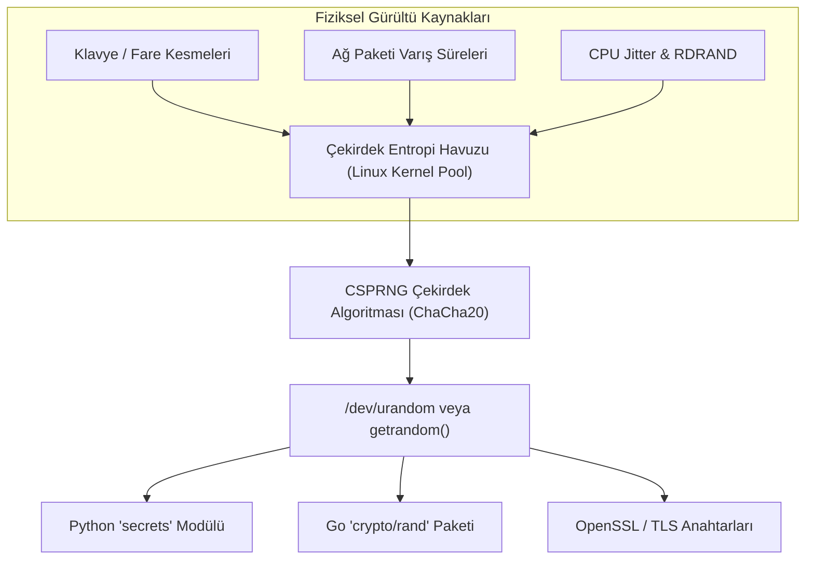

Kriptografinin en güçlü matematiksel tasarımı bile, kullandığı anahtar tahmin edilebilir bir rastgelelikle üretilmişse saniyeler içinde çöker. Rastgelelik, kriptografik zırhın ilk harcıdır.

---

## 1. Teorik Sezgi & Matematik

### PRNG vs. CSPRNG

* **PRNG (Sözde Rastgele Sayı Üreteci):** Matematiksel bir başlangıç tohumu (*seed*) alarak deterministik bir dizi sayı üretir (örneğin *Linear Congruential Generator* veya Python'ın varsayılan *Mersenne Twister / `random`* modülü). Simülasyonlar ve istatistik için hızlıdır; ancak **kriptografik olarak güvenli değildir**. Çıktının belirli bir kısmı gözlemlendiğinde tüm iç durum (*internal state*) rekonstrükte edilebilir.
* **CSPRNG (Kriptografik Güvenli PRNG):** Bir sonraki bitin tahmin edilemezliği testini (*Next-Bit Test*) geçen ve geçmiş durumunun ele geçirilmesi halinde önceki çıktıların hesaplanamaz olduğu (*State Compromise Extension / Forward Secrecy*) üreteçlerdir.

### Entropi Havuzu ve İşletim Sistemi Mimarisi

İşletim sistemi çekirdeği (Linux/Windows), öngörülemez fiziksel olaylardan entropi toplar:
* Donanım kesme zamanlamaları (klavye, fare, disk I/O)
* CPU termal dalgalanmaları ve saat sapmaları (*clock jitter*)
* Donanım tabanlı üreteçler (Intel RDRAND / RDSEED talimatları)

Toplanan bu ham gürültü, bir kriptografik özet fonksiyonundan (örneğin ChaCha20 veya SHA-256) geçirilerek entropi havuzuna beslenir.



---

## 2. Gerçek Hayat Mimarisi

* **Linux:** Modern çekirdeklerde `/dev/random` ve `/dev/urandom` ayrımı pratikte kalkmıştır; her ikisi de çekirdeğin ChaCha20 tabanlı CSPRNG havuzundan beslenir. Güvenli sistem çağrısı `getrandom()`'dır.
* **Windows:** Windows CryptoAPI ve CNG (Cryptography Next Generation) altyapısında `BCryptGenRandom` fonksiyonu kullanılır.
* **Bulut ve Sanallaştırma:** Yeni başlatılan sanal makinelerde (VM snapshot / clone) yeterli entropi toplanmadan anahtar üretilmesi ciddi bir risk oluşturur; bu nedenle bulut hipervizörleri sanal makineye `virtio-rng` donanımı tanımlar.

---

## 3. Uygulamalı Kod Örneği: Go ile Kriptografik Rastgele Anahtar ve Token Üretimi

Go standart kütüphanesindeki `crypto/rand` paketi işletim sisteminin CSPRNG arayüzünü doğrudan kullanır.

```go
package main

import (
	"crypto/rand"
	"encoding/hex"
	"fmt"
	"io"
)

// GenerateSecureKey 256-bit (32 byte) kriptografik anahtar üretir
func GenerateSecureKey() ([]byte, error) {
	key := make([]byte, 32)
	// crypto/rand.Reader işletim sisteminin CSPRNG havuzunu okur
	_, err := io.ReadFull(rand.Reader, key)
	if err != nil {
		return nil, fmt.Errorf("entropi kaynağı okunamadı: %w", err)
	}
	return key, nil
}

// GenerateSessionToken Hex formatında güvenli oturum tokenı üretir
func GenerateSessionToken(byteLength int) (string, error) {
	b := make([]byte, byteLength)
	if _, err := rand.Read(b); err != nil {
		return "", err
	}
	return hex.EncodeToString(b), nil
}

func main() {
	key, err := GenerateSecureKey()
	if err != nil {
		panic(err)
	}
	fmt.Printf("[+] Üretilen 256-bit AES/ChaCha Anahtarı: %s\n", hex.EncodeToString(key))

	token, _ := GenerateSessionToken(16)
	fmt.Printf("[+] Güvenli Web Oturum Tokenı: %s\n", token)
}
```

---

## 4. Güvenlik & Kriptanaliz Notu

> [!CAUTION]
> **Tarihsel Felaket: Debian OpenSSL Zafiyeti (CVE-2008-0166)**
> 2008 yılında bir Debian geliştiricisi, Valgrind bellek uyarılarını susturmak için OpenSSL'deki entropi toplayıcı döngüyü kaldırdı. Bunun sonucunda anahtar üretimindeki tek değişken işletim sisteminin o anki işlem numarası (PID) oldu ($0$ ile $32767$ arası). 
> Dünya çapında üretilen milyonlarca SSH ve SSL anahtarının uzayı sadece 32.768 ihtimale düştü ve saldırganlar birkaç saniye içinde tüm açık anahtarların gizli karşılıklarını brute-force ile deşifre etti.
> **Kural:** Asla kendi rastgelelik fonksiyonunuzu yazmayın, `math/rand` (Go) veya `random` (Python) gibi kütüphaneleri güvenlik anahtarlarında asla kullanmayın!

