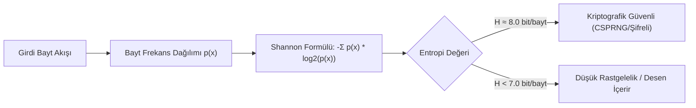

Bu laboratuvarda; modül boyunca öğrendiğimiz matematiksel yapı taşlarını (modüler üs alma, modüler ters) birleştiren bir modüler hesap makinesi geliştirecek ve rastgelelik kaynaklarının kalitesini ölçen bir **Shannon Entropi Test Aracı** kodlayacağız.

---

## 1. Laboratuvar Amacı ve Mimarisi

* **Bölüm 1:** Büyük sayılarla çalışan, Genişletilmiş Öklid ve Hızlı Üs Alma algoritmalarını içeren `ModularMath` sınıfı.
* **Bölüm 2:** Bayt akışlarının entropisini ($0.0 - 8.0$ bit/bayt arası) ölçen ve `random` (PRNG) ile `secrets` (CSPRNG) arasındaki farkı görselleştiren `EntropyTester`.



---

## 2. Tam Laboratuvar Kodu (Python)

Aşağıdaki betik harici hiçbir bağımlılık gerektirmeden standart Python kütüphaneleriyle çalışır.

```python
import math
import os
import random
import secrets
from collections import Counter

class ModularMath:
    @staticmethod
    def power(base: int, exp: int, mod: int) -> int:
        """Hızlı İkili Üs Alma (Square-and-Multiply): O(log exp)"""
        res = 1
        base = base % mod
        while exp > 0:
            if exp % 2 == 1:
                res = (res * base) % mod
            exp = exp // 2
            base = (base * base) % mod
        return res

    @staticmethod
    def extended_gcd(a: int, b: int):
        if a == 0:
            return b, 0, 1
        gcd, x1, y1 = ModularMath.extended_gcd(b % a, a)
        x = y1 - (b // a) * x1
        y = x1
        return gcd, x, y

    @classmethod
    def inverse(cls, a: int, m: int) -> int:
        gcd, x, _ = cls.extended_gcd(a, m)
        if gcd != 1:
            raise ArithmeticError(f"{a} ve {m} aralarında asal değildir, tersi yoktur!")
        return (x % m + m) % m


class EntropyAnalyzer:
    @staticmethod
    def calculate_shannon_entropy(data: bytes) -> float:
        """Bayt verisi için Shannon Entropisini hesaplar (Maksimum 8.0 bit/bayt)."""
        if not data:
            return 0.0

        length = len(data)
        counts = Counter(data)
        entropy = 0.0

        for count in counts.values():
            p_x = count / length
            entropy -= p_x * math.log2(p_x)

        return entropy

    @classmethod
    def run_benchmark(cls, sample_size: int = 100000):
        print(f"\n{'='*55}")
        print(f"[*] RASTGELELİK VE ENTROPİ BENCHMARK ({sample_size} Bayt)")
        print(f"{'='*55}")

        # 1. Düşük Entropili Düz Metin
        plain_text = b"Kriptoloji bilimi guvenligin temel tasidir." * (sample_size // 40)
        e_plain = cls.calculate_shannon_entropy(plain_text)
        print(f"[-] Düz Metin (ASCII) Entropisi       : {e_plain:.4f} bit/bayt")

        # 2. PRNG (Python 'random' modülü - Mersenne Twister)
        prng_data = bytes(random.getrandbits(8) for _ in range(sample_size))
        e_prng = cls.calculate_shannon_entropy(prng_data)
        print(f"[~] PRNG (Mersenne Twister) Entropisi : {e_prng:.4f} bit/bayt")

        # 3. CSPRNG (İşletim Sistemi Çekirdeği - os.urandom / secrets)
        csprng_data = os.urandom(sample_size)
        e_csprng = cls.calculate_shannon_entropy(csprng_data)
        print(f"[+] CSPRNG (os.urandom) Entropisi     : {e_csprng:.4f} bit/bayt")
        print(f"{'='*55}")


if __name__ == "__main__":
    # 1. Modüler Aritmetik Testi
    print("[*] 1. Modüler Aritmetik Testi:")
    mod = 1000000007
    a, exp = 65537, 12345678
    res = ModularMath.power(a, exp, mod)
    print(f"    {a}^{exp} mod {mod} = {res}")

    inv = ModularMath.inverse(65537, mod)
    print(f"    65537 mod {mod}'deki tersi: {inv}")
    assert (65537 * inv) % mod == 1
    print("    [+] Ters doğrulandı: (a * a^-1) % mod == 1")

    # 2. Entropi Analizi
    EntropyAnalyzer.run_benchmark(50000)
```

---

## 3. Güvenlik & Kriptanaliz Notu

> [!NOTE]
> **Yüksek Entropi Tek Başına Güvenlik Anlamına Gelmez**
> Sıkıştırılmış bir dosya (örneğin `.zip` veya `.gz`) ya da zayıf bir şifreleme algoritması (örneğin RC4) da 7.99 bit/bayt entropi üretir. Entropi testleri verinin rastgele dağılıp dağılmadığını ölçer; ancak bir üretecin kriptanalitik sağlamlığını (kestirilemezliğini) tek başına kanıtlayamaz. Gerçek kriptografik testler için NIST SP 800-22 test süiti ve Dieharder istatistik testleri uygulanır.
