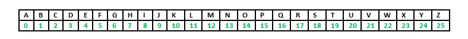
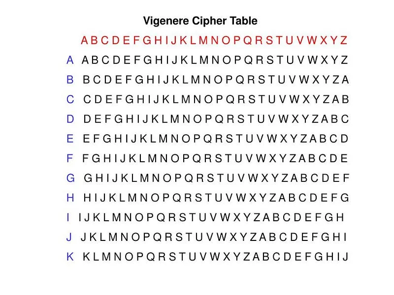
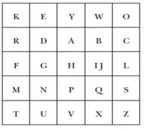
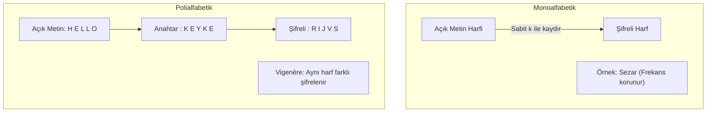

Klasik kriptoloji; bilgisayarların henüz var olmadığı dönemlerde kağıt, kalem ve mekanik düzeneklerle uygulanan iki temel ilkeye dayanır: **Harf Değiştirme (*Substitution*)** ve **Yer Değiştirme (*Transposition*)**.

---

## 1. Teorik Sezgi & Matematik

### 1. Sezar Şifresi (Monoalfabetik Kaydırma)

Alfabedeki her harfi sabit bir $k$ adımı kadar ileri kaydırır. Matematiksel olarak $\mathbb{Z}_{26}$ (veya Türkçe alfabe için $\mathbb{Z}_{29}$) üzerinde modüler toplama işlemidir:

$$C_i \equiv (P_i + k) \pmod{26}$$
$$P_i \equiv (C_i - k) \pmod{26}$$

Anahtar uzayı $|\mathcal{K}| = 25$'tir. Bu kadar küçük bir anahtar uzayı saniyeler içinde kaba kuvvetle (*brute-force*) taranabilir. Benzer şekilde, afin şifreleme gibi doğrusal modüler dönüşümlerde de harfler matematiksel formüllerle ($C \equiv (aP + b) \pmod{m}$) doğrudan birbirine eşlenir.



### 2. Atbash Şifresi (Ayna Dönüşümü)

İbrani alfabesinden doğan bu yöntemde alfabenin ilk harfi son harfiyle, ikinci harfi sondan bir öncekiyle eşleştirilir:

$$C_i \equiv (25 - P_i) \pmod{26}$$

Sabit bir dönüşüm olduğu için gizli bir anahtarı yoktur; algoritmanın bilinmesi çözülmesi için yeterlidir (Kerckhoffs ilkesine aykırıdır).

### 3. Vigenère Şifresi (Polialfabetik Şifreleme)

Blaise de Vigenère tarafından geliştirilen bu yöntemde, tek bir sabit kaydırma yerine bir anahtar kelime ($K$) döngüsel olarak tekrarlanır. Her harf farklı bir Sezar kaydırmasına tabi tutulur:

$$C_i \equiv (P_i + K_{i \pmod L}) \pmod{26}$$

Burada $L$, anahtar kelimenin uzunluğudur. Vigenère şifresi, monoalfabetik frekans analizini bozduğu için yüzyıllar boyunca *"le chiffre indéchiffrable"* (kırılamaz şifre) olarak anılmıştır.





### 4. Playfair ve Scytale

* **Scytale (Transposition):** Antik Sparta'da belirli kalınlıkta tahta bir silindire sarılan deri şeride harflerin yazılmasıyla uygulanır. Harfler değişmez, sadece sırası değişir.
* **Playfair Şifresi:** 5x5'lik bir harf matrisi kullanarak harfleri ikili gruplar (*digraph*) halinde şifreler. Frekans analizini harf düzeyinden ikili harf düzeyine çıkararak zorlaştırır.



---

## 2. Gerçek Hayat Mimarisi

* **Eğlence ve Basit Gizleme:** Sezar şifresinin özel bir hali olan **ROT13** ($k = 13$), Usenet forumlarından modern Linux terminal araçlarına kadar forumlardaki spoiler'ları veya şakaları gizlemek için halen yaygın olarak kullanılır ($ROT13(ROT13(x)) = x$).
* **Modern Blok Şifreleyiciler:** Modern AES algoritmasındaki **SubBytes** adımı doğrudan bir ikame (*substitution*), **ShiftRows** adımı ise yer değiştirme (*transposition*) prensibinin sonlu alanlardaki ($GF(2^8)$) gelişmiş bir türevidir.

---

## 3. Uygulamalı Kod Örneği: Python ile Vigenère Şifreleme / Deşifreleme

```python
def vigenere_cipher(text: str, key: str, decrypt: bool = False) -> str:
    """Polialfabetik Vigenère şifreleme ve deşifreleme fonksiyonu (A-Z)."""
    result = []
    key = key.upper()
    key_indices = [ord(k) - ord('A') for k in key]
    key_len = len(key)
    key_idx = 0

    for char in text.upper():
        if 'A' <= char <= 'Z':
            p_val = ord(char) - ord('A')
            k_val = key_indices[key_idx % key_len]
            if decrypt:
                c_val = (p_val - k_val) % 26
            else:
                c_val = (p_val + k_val) % 26
            result.append(chr(c_val + ord('A')))
            key_idx += 1
        else:
            result.append(char)

    return "".join(result)

# Test
plain = "SAVUNMA_SANAYII_KRIPTO_LAB"
secret_key = "GUVENLIK"

ciphertext = vigenere_cipher(plain, secret_key)
recovered = vigenere_cipher(ciphertext, secret_key, decrypt=True)

print(f"[+] Açık Metin    : {plain}")
print(f"[+] Şifreli Metin : {ciphertext}")
print(f"[+] Çözülen Metin : {recovered}")
assert plain == recovered
```

---

## 4. Güvenlik & Kriptanaliz Notu

:::danger[Klasik Şifrelerin Temel Zaafları]
* **Sezar/Atbash:** Harf frekansı doğrudan korunur. Türkçe metinde en çok geçen harf olan 'A' veya 'E', şifreli metindeki en sık harf tespit edilerek anında kırılır.
* **Vigenère:** Anahtar uzunluğu ($L$) tespit edildiği anda şifre, $L$ adet bağımsız Sezar şifresine ayrışır ve her biri frekans analiziyle çözülür (Bkz: Modül 2.4 Kasiski Testi).
:::

