İkinci Dünya Savaşı'nın seyrini değiştiren Enigma makinesi, klasik kağıt-kalem şifrelemesinden modern makine kriptografisine geçişin en ikonik temsilcisidir. 

---

## 1. Teorik Sezgi & Matematik

Enigma, elektriksel devreler aracılığıyla polialfabetik yer değiştirmeyi fiziksel olarak otomatikleştiren bir elektromekanik şifreleme makinesidir.

### Temel Bileşenler

1. **Klavye & Lamba Panosu:** Kullanıcının harf girdiği ve şifreli harfin yandığı 26 harflik arayüz.
2. **Fiş Panosu (*Steckerbrett*):** Makinenin ön yüzündeki 10 çift harfi birbiriyle takas eden ikame katmanı (kombinasyonel anahtar uzayını $\approx 1.5 \times 10^{14}$ kat büyütür).
3. **Dönen Rotörler (*Walzen*):** Her harf basışında saat mekanizması gibi dönen (hızlı, orta, yavaş) ve iç kablolaması sabit harf permütasyonları içeren çarklar ($P_1, P_2, P_3$).
4. **Reflektör (*Umkehrwalze - UKW*):** Akımı rotörlerden geçtikten sonra toplayıp farklı bir yoldan tekrar rotörlerin içinden klavyeye geri gönderen sabit çark.

```mermaid
flowchart LR
    K["Tuş Basımı (Örn: A)"] --> S1["Fiş Panosu (Plugboard)"]
    S1 --> R1["Rotör 1 (Hızlı)"]
    R1 --> R2["Rotör 2 (Orta)"]
    R2 --> R3["Rotör 3 (Yavaş)"]
    R3 --> REF["Reflektör (UKW)"]
    REF --> R3_rev["Rotör 3 (Ters)"]
    R3_rev --> R2_rev["Rotör 2 (Ters)"]
    R2_rev --> R1_rev["Rotör 1 (Ters)"]
    R1_rev --> S2["Fiş Panosu (Ters)"]
    S2 --> L["Lamba Paneli (Örn: G)"]
```



### Reflektörün Matematiksel Doğası ve Ölümcül Kusuru

Reflektör, devreyi simetrik kılar. Bu sayede makineye şifreli metin girildiğinde aynı anahtar ayarlarıyla açık metin lambalarda yanar (ayrı bir deşifre moduna ihtiyaç duyulmaz):

$$E_K(E_K(x)) = x$$

Ancak bu mekanik kolaylık Enigma'nın mezarını kazmıştır:
> **Ölümcül Zaaf:** Reflektör kabloları harfleri çiftler halinde eşleştirdiği için; **bir harf asla ve asla kendi kendisine şifrelenemez!**
> $$E_K(x) \neq x \quad (\forall x \in \Sigma)$$

---

## 2. Gerçek Hayat Mimarisi: Bletchley Park ve Turing Bombe

İngiltere'deki Bletchley Park'ta matematikçi **Alan Turing** ve **Gordon Welchman**, Enigma'nın bu kuralını kullanarak bilinen açık metin saldırıları (*Known-Plaintext Attack - Crib*) kurgulamıştır.

Alman ordusu her sabah saat 06:05'te aynı formatta hava durumu raporu gönderiyordu. Raporda geçen *"WETTERVORHERSAGE"* (hava durumu tahmini) kelimesi şifreli metin üzerinde kaydırılıyor; şifreli metinle açık metinde tek bir harf bile üst üste çakışıyorsa o pozisyon doğrudan eleniyordu. 

Turing'in tasarladığı elektromekanik **Bombe** makineleri, mantıksal çelişkileri (kapalı devre döngülerini) tarayarak rotor başlangıç konumlarını saatler içinde eliyor ve iletişimi çözüyordu.

---

## 3. Uygulamalı Kod Örneği: Python ile Basitleştirilmiş Rotor Simülasyonu

Aşağıdaki betik; dönen tek bir rotor, bir reflektör ve bir harfin kendisine asla şifrelenmediği Enigma mantığını modeller.

```python
class SimpleEnigma:
    def __init__(self, wiring: str, reflector: str, position: int = 0):
        self.wiring = wiring          # Rotor iç kablolaması
        self.reflector = reflector    # Reflektör eşleşmesi
        self.position = position      # Rotorun o anki konumu (0-25)

    def step(self):
        """Her harf girişinde rotor bir adım döner."""
        self.position = (self.position + 1) % 26

    def encrypt_char(self, c: str) -> str:
        if not ('A' <= c <= 'Z'):
            return c

        input_idx = (ord(c) - ord('A') + self.position) % 26
        
        # 1. Rotordan ileri geçiş
        forward_char = self.wiring[input_idx]
        forward_idx = (ord(forward_char) - ord('A') - self.position) % 26
        
        # 2. Reflektörden yansıma
        reflected_char = self.reflector[forward_idx]
        reflected_idx = (ord(reflected_char) - ord('A') + self.position) % 26
        
        # 3. Rotordan geri geçiş
        backward_char = chr(self.wiring.index(chr(reflected_idx + ord('A'))) + ord('A'))
        output_char = chr((ord(backward_char) - ord('A') - self.position) % 26 + ord('A'))

        self.step()
        return output_char

# Test: Rotor I (EKMFLGDQVZNTOWYHXUSPAIBRCJ) ve Reflektör B (YRUHQSLDPXNGOKMIEBFZCWVJAT)
ROTOR_I = "EKMFLGDQVZNTOWYHXUSPAIBRCJ"
REFLECTOR_B = "YRUHQSLDPXNGOKMIEBFZCWVJAT"

enigma = SimpleEnigma(ROTOR_I, REFLECTOR_B, position=0)

plain = "HELLOWORLD"
cipher = "".join(enigma.encrypt_char(c) for c in plain)
print(f"[+] Açık Metin    : {plain}")
print(f"[+] Şifreli Metin : {cipher}")

# Enigma Kuralı Kanıtı: Hiçbir harf kendi karşılığıyla eşleşemez
for p, c in zip(plain, cipher):
    assert p != c, f"Kusur tespit edildi: {p} == {c}"
print("[+] Doğrulandı: Hiçbir harf kendisiyle eşleşmedi (E(x) != x)")
```

---

## 4. Güvenlik & Kriptanaliz Notu

:::caution[Kullanıcı Hatası Kriptografiyi Yıkar]
Enigma'nın kırılmasındaki en büyük katalizör matematiksel kusurdan ziyade operatör disiplinsizliğiydi:
1. Tembel operatörlerin rotor başlangıç konumları için sevgililerinin baş harflerini veya klavyedeki ardışık üç harfi (`Q-W-E`) seçmesi.
2. Standart selamlama kalıpları (*"Heil Hitler"*, *"Keine besonderen Vorkommnisse"* - kayda değer olay yok).
Modern sistemlerde insan faktörünün anahtar seçimine dahil edilmemesi (tam otomatik CSPRNG zorunluluğu) Enigma'dan çıkarılan en büyük derstir.
:::

