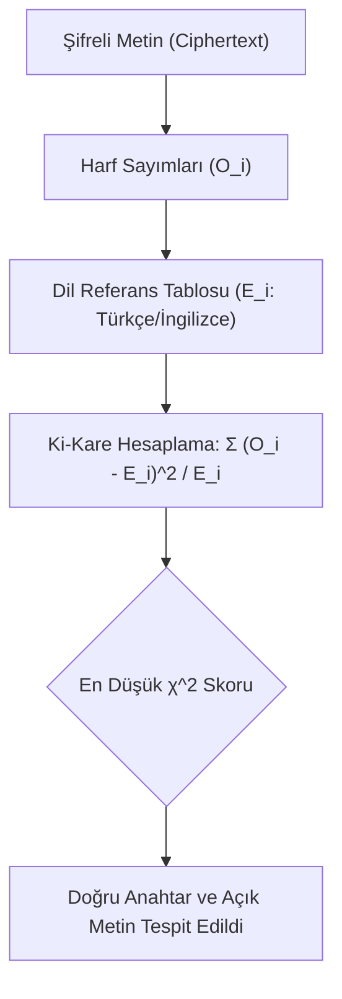

9. yüzyılda Bağdat'ta yaşayan Arap bilgin **El-Kindi**, *“Kriptografik Mesajların Deşifre Edilmesine Dair Elyazması”* adlı eserinde frekans analizini icat ederek kriptanaliz biliminin temelini atmıştır.

---

## 1. Teorik Sezgi & Matematik

Doğal diller (Türkçe, İngilizce, Almanca vb.) rastgele harf dizilerinden oluşmaz; her dilin kendine has bir akustik ve gramer yapısı vardır. Bir metin monoalfabetik olarak şifrelendiğinde harflerin sembolleri değişir ancak **istatistiksel frekans dağılımları korunur**.

### Harf Frekans İmzaları

* **Türkçe:** En sık harfler sırasıyla **A (%11.9)**, **E (%8.9)**, **İ (%8.6)**, **N (%7.4)**, **R (%6.7)**, **L (%6.0)**. En seyrek harfler: **J (%0.03)**, **F (%0.4)**.
* **İngilizce:** En sık harfler sırasıyla **E (%12.7)**, **T (%9.1)**, **A (%8.2)**, **O (%7.5)**, **I (%7.0)**, **N (%6.7)**.

### Ki-Kare ($\chi^2$) Uygunluk Testi

Şifreli metinden elde edilen gözlemlenen frekansların ($O_i$), hedef dilin beklenen frekanslarına ($E_i$) ne kadar uyduğunu ölçmek için Ki-Kare istatistiği kullanılır:

$$\chi^2 = \sum_{i=1}^{n} \frac{(O_i - E_i)^2}{E_i}$$

* $\chi^2$ değeri **sıfıra ne kadar yakınsa**, şifresi çözülen metin hedef dilin doğal yapısına o kadar uygundur.



---

## 2. Gerçek Hayat Mimarisi

* **Zararlı Yazılım Analizi:** Saldırganların komuta kontrol (C2) trafiğinde veya bellek içi enjeksiyonlarda kullandığı basit XOR / tek baytlık yer değiştirme rutinleri, güvenlik analistleri ve EDR motorları tarafından $\chi^2$ ve entropi imzalarıyla anında tespit edilir.
* **CTF ve Adli Bilişim:** Şifrelenmiş konfigürasyon dosyaları veya gizlenmiş string'ler otomatik frekans kütüphaneleriyle saniyeler içinde açığa çıkarılır.

---

## 3. Uygulamalı Kod Örneği: Python ile Otomatik Sezar Kırıcı (Ki-Kare Testi)

Aşağıdaki Python kodu; 25 olası kaydırmayı dener, her biri için İngilizce harf frekanslarına göre $\chi^2$ puanı hesaplar ve insan müdahalesine gerek kalmadan doğru metni bulur.

```python
import string

# İngilizce harf frekansları (A-Z yüzdeleri)
ENGLISH_FREQ = [
    0.08167, 0.01492, 0.02782, 0.04253, 0.12702, 0.02228, 0.02015,
    0.06094, 0.06966, 0.00153, 0.00772, 0.04025, 0.02406, 0.06749,
    0.07507, 0.01929, 0.00095, 0.05987, 0.06327, 0.09056, 0.02758,
    0.00978, 0.02360, 0.00150, 0.01974, 0.00074
]

def calculate_chi_squared(text: str) -> float:
    """Metnin İngilizce dil frekansına uygunluk skorunu hesaplar."""
    clean_text = [c.upper() for c in text if c.isalpha()]
    total_letters = len(clean_text)
    if total_letters == 0:
        return float('inf')

    counts = [0] * 26
    for c in clean_text:
        counts[ord(c) - ord('A')] += 1

    chi_sq = 0.0
    for i in range(26):
        expected = total_letters * ENGLISH_FREQ[i]
        observed = counts[i]
        if expected > 0:
            chi_sq += ((observed - expected) ** 2) / expected
    return chi_sq

def break_caesar(ciphertext: str):
    """En düşük Ki-Kare skoruna sahip anahtarı ve açık metni bulur."""
    best_shift = 0
    best_score = float('inf')
    best_plaintext = ""

    for shift in range(26):
        candidate = []
        for char in ciphertext:
            if char.isalpha():
                base = ord('A') if char.isupper() else ord('a')
                candidate.append(chr((ord(char) - base - shift) % 26 + base))
            else:
                candidate.append(char)
        plain = "".join(candidate)
        score = calculate_chi_squared(plain)

        if score < best_score:
            best_score = score
            best_shift = shift
            best_plaintext = plain

    return best_shift, best_plaintext, best_score

# Test
cipher = "WKLV LV D VHFUHW PHVVDJH DERXW FUBSWRJUDSKB DQG QHWZRUN VHFXULWB"
shift, text, score = break_caesar(cipher)

print(f"[+] Şifreli Metin : {cipher}")
print(f"[+] Tespit Edilen Kaydırma (Key) : {shift}")
print(f"[+] Çözülen Açık Metin          : {text}")
print(f"[+] Ki-Kare Uyum Skoru          : {score:.2f}")
```

---

## 4. Güvenlik & Kriptanaliz Notu

> [!IMPORTANT]
> **Anahtar Uzayının Büyüklüğü Kriptografik Dayanıklılık Anlamına Gelmez**
> Genel bir monoalfabetik ikame şifresinde (her harf rastgele farklı bir harfe eşlenirse) anahtar uzayı $26! \approx 4.03 \times 10^{26}$ ihtimaldir. Bu sayı modern süper bilgisayarların kaba kuvvetle tarayamayacağı kadar büyüktür. Ancak **harf frekans analizi** sayesinde bu devasa anahtar uzayı brute-force'a gerek kalmadan birkaç saniyede kırılır. 
> Modern simetrik kriptografi (AES), Shannon'ın tanımladığı **Karışıklık (Confusion)** ve **Yayılma (Diffusion)** ilkeleriyle açık metin istatistiklerini şifreli metinde tamamen yok eder.

