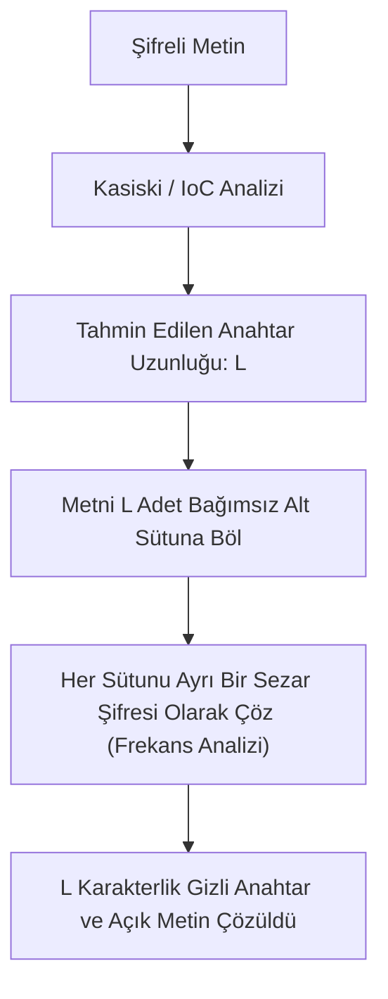

Yüzyıllar boyunca *"kırılamaz"* kabul edilen Vigenère şifresi, 19. yüzyılda Prusyalı subay **Friedrich Kasiski** ve 20. yüzyılda modern kriptanalizin öncüsü **William Friedman** tarafından geliştirilen iki devrimsel yöntemle çözülmüştür.

---

## 1. Teorik Sezgi & Matematik

Vigenère şifresindeki temel kusur **periyodikliktir**. Eğer $L$ uzunluğunda bir anahtar kelime kullanılıyorsa, açık metindeki aynı kelime grupları tesadüfen anahtarın aynı pozisyonuna denk geldiğinde şifreli metinde **tamamen aynı harf bloklarını** üretir.

### 1. Kasiski İncelemesi (Kasiski Examination)

1. Şifreli metin taranarak en az 3 harfli tekrarlayan gruplar (trigram/tetragram) bulunur.
2. Bu tekrarlar arasındaki mesafeler ($d_1, d_2, d_3, \dots$) ölçülür.
3. Mesafelerin ortak bölenleri (EBOB) hesaplanır:
   $$L \mid \gcd(d_1, d_2, d_3, \dots)$$
   Ortak bölen, kullanılan anahtar kelimenin uzunluğudur ($L$).

### 2. Friedman Testi ve Çakışma İndeksi (Index of Coincidence - IoC)

William Friedman, 1922 yılında metinden rastgele seçilen iki harfin aynı olma olasılığını hesaplayan **Çakışma İndeksi** formülünü geliştirmiştir:

$$IoC = \frac{\sum_{i=1}^{26} f_i (f_i - 1)}{N (N - 1)}$$

Burada $f_i$ her harfin frekansı, $N$ ise toplam harf sayısıdır.

* **Tamamen Rastgele Metin (Uniform Dağılım):** $IoC \approx \frac{1}{26} \approx 0.0385$
* **Doğal İngilizce Metin:** $IoC \approx 0.0667$
* **Doğal Türkçe Metin:** $IoC \approx 0.0650$

Eğer bir şifreli metnin $IoC$ değeri $0.038$'e yakınsa, polialfabetik bir şifreleme uygulanmıştır. Anahtar uzunluğu $L$ şu formülle tahmin edilir:

$$L \approx \frac{0.0667 - 0.0385}{IoC - 0.0385 + \frac{0.0667 - IoC}{N}}$$



---

## 2. Gerçek Hayat Mimarisi

* **Blok Şifreleyici Tasarımına Etkisi:** Kasiski analizi modern kriptograflara çok önemli bir ders vermiştir: **Şifreleme asla periyodik ve bağımsız bloklar halinde yapılmamalıdır.** 
* Modern AES'te bu durum CBC modundaki **Başlatma Vektörü (IV)** veya CTR modundaki **Sayaç (Nonce)** mimarisiyle çözülmüş; her bloğun şifresi önceki bloğa veya bir sayaca bağlanarak periyodik desenler yok edilmiştir.

---

## 3. Uygulamalı Kod Örneği: Python ile Çakışma İndeksi (IoC) Hesaplayıcı

```python
from collections import Counter

def calculate_ioc(text: str) -> float:
    """Metnin Çakışma İndeksini (Index of Coincidence) hesaplar."""
    clean_text = [c.upper() for c in text if c.isalpha()]
    n = len(clean_text)
    if n <= 1:
        return 0.0

    counts = Counter(clean_text)
    numerator = sum(f * (f - 1) for f in counts.values())
    denominator = n * (n - 1)

    return numerator / denominator

def estimate_key_length(ciphertext: str, max_len: int = 10):
    """Farklı anahtar uzunluğu hipotezleri için ortalama alt-dilim IoC değerlerini test eder."""
    clean = [c.upper() for c in ciphertext if c.isalpha()]
    print("[*] ANAHTAR UZUNLUĞU HİPOTEZ TESTİ:")
    print("---------------------------------------")
    
    for l in range(1, max_len + 1):
        slices = [clean[i::l] for i in range(l)]
        avg_ioc = sum(calculate_ioc("".join(s)) for s in slices) / l
        status = "<- MUHTEMEL ANAHTAR!" if avg_ioc > 0.060 else ""
        print(f"L = {l:2d} | Ortalama IoC: {avg_ioc:.4f} {status}")

# Test verisi: 'SECURITY' (8 harf) anahtarıyla şifrelenmiş Vigenère metni
cipher_sample = (
    "KZESWMIQZWVUKZESWMIQZWVUKZESWMIQZWVU"
    "VWWQVYXCWVGMWVGMWVGMEQZWVUKZESWMIQZW"
    "MZWVUKZESWMIQZWVUVWWQVYXCWVGMWVGMEQZ"
)

estimate_key_length(cipher_sample, max_len=10)
```

---

## 4. Güvenlik & Kriptanaliz Notu

> [!WARNING]
> **Bilinen Açık Metin Saldırısı (Known-Plaintext Attack - KPA)**
> Vigenère şifrelemesinde açık metnin sadece birkaç harfi (örneğin belgenin başındaki *"Sayın Yetkili"* veya *"HTTP/1.1"*) biliniyorsa; anahtar doğrudan şu formülle çıkarılır:
> $$K_i \equiv (C_i - P_i) \pmod{26}$$
> Anahtarın birkaç harfi ele geçirildiğinde, kelimenin tamamı sözlük saldırısıyla tamamlanır ve belgenin kalanı anında deşifre olur.

