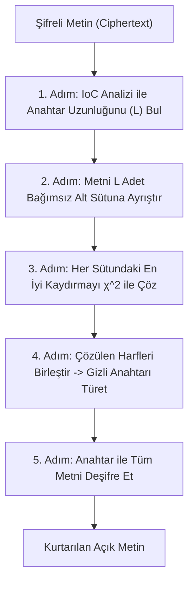

Bu laboratuvarda; kriptanaliz teorisinde öğrendiğimiz **Çakışma İndeksi (IoC)** ve **Ki-Kare ($\chi^2$) Uygunluk Testi** algoritmalarını birleştirerek, anahtarı bilinmeyen bir Vigenère şifreli metnini hiçbir insan müdahalesi olmadan çözen tam otomatik bir Python aracı geliştireceğiz.

---

## 1. Otomasyon Boru Hattı Mimarisi



---

## 2. Tam Laboratuvar Kodu (Python)

```python
from collections import Counter
import math

ENGLISH_FREQ = [
    0.08167, 0.01492, 0.02782, 0.04253, 0.12702, 0.02228, 0.02015,
    0.06094, 0.06966, 0.00153, 0.00772, 0.04025, 0.02406, 0.06749,
    0.07507, 0.01929, 0.00095, 0.05987, 0.06327, 0.09056, 0.02758,
    0.00978, 0.02360, 0.00150, 0.01974, 0.00074
]

class VigenereBreaker:
    @staticmethod
    def calculate_ioc(text: str) -> float:
        n = len(text)
        if n <= 1:
            return 0.0
        counts = Counter(text)
        return sum(f * (f - 1) for f in counts.values()) / (n * (n - 1))

    @classmethod
    def find_key_length(cls, text: str, max_len: int = 16) -> int:
        best_len = 1
        best_diff = float('inf')

        for l in range(1, max_len + 1):
            slices = [text[i::l] for i in range(l)]
            avg_ioc = sum(cls.calculate_ioc(s) for s in slices) / l
            # İngilizce hedef IoC ~ 0.0667'ye en yakın olanı seç
            diff = abs(avg_ioc - 0.0667)
            if diff < best_diff and avg_ioc > 0.055:
                best_diff = diff
                best_len = l

        return best_len

    @staticmethod
    def break_single_caesar(column: str) -> str:
        """Ki-Kare testiyle tek bir sütundaki en olası Sezar kaydırma harfini bulur."""
        n = len(column)
        best_shift = 0
        best_score = float('inf')

        for shift in range(26):
            counts = [0] * 26
            for c in column:
                shifted = (ord(c) - ord('A') - shift) % 26
                counts[shifted] += 1

            chi_sq = 0.0
            for i in range(26):
                expected = n * ENGLISH_FREQ[i]
                if expected > 0:
                    chi_sq += ((counts[i] - expected) ** 2) / expected

            if chi_sq < best_score:
                best_score = chi_sq
                best_shift = shift

        return chr(best_shift + ord('A'))

    @classmethod
    def crack(cls, ciphertext: str, max_key_len: int = 16):
        clean_text = "".join(c.upper() for c in ciphertext if c.isalpha())
        
        # 1. Anahtar Uzunluğunu Bul
        key_len = cls.find_key_length(clean_text, max_key_len)
        print(f"[*] 1. Aşama: Tespit edilen anahtar uzunluğu: {key_len}")

        # 2. Sütunları Ayrı Ayrı Çözerek Anahtar Kelimeyi İnşa Et
        recovered_key = []
        for i in range(key_len):
            col = clean_text[i::key_len]
            best_char = cls.break_single_caesar(col)
            recovered_key.append(best_char)

        key_str = "".join(recovered_key)
        print(f"[+] 2. Aşama: Çözülen gizli anahtar: {key_str}")

        # 3. Metni Deşifre Et
        plaintext = []
        for idx, char in enumerate(clean_text):
            k = ord(key_str[idx % key_len]) - ord('A')
            p = (ord(char) - ord('A') - k) % 26
            plaintext.append(chr(p + ord('A')))

        return key_str, "".join(plaintext)


if __name__ == "__main__":
    # Test Metni ve Gizli Anahtar
    secret_key = "CRYPTO"
    raw_message = (
        "CRYPTOGRAPHY IS THE PRACTICE AND STUDY OF TECHNIQUES FOR SECURE COMMUNICATION "
        "IN THE PRESENCE OF ADVERSARIAL THIRD PARTIES. MODERN CRYPTOGRAPHY INTERSECTS "
        "MATHEMATICS, COMPUTER SCIENCE, INFORMATION SECURITY, AND ELECTRICAL ENGINEERING."
    )
    
    # Şifreleme işlemi
    clean_raw = [c for c in raw_message.upper() if c.isalpha()]
    cipher_chars = []
    for i, c in enumerate(clean_raw):
        k = ord(secret_key[i % len(secret_key)]) - ord('A')
        cipher_chars.append(chr((ord(c) - ord('A') + k) % 26 + ord('A')))
    sample_ciphertext = "".join(cipher_chars)

    print(f"[~] Şifreli Metin (İlk 60 karakter): {sample_ciphertext[:60]}...")
    
    # Kriptanaliz Motorunu Çalıştır
    cracked_key, decrypted_text = VigenereBreaker.crack(sample_ciphertext)
    
    print(f"\n[✓] Başarılı Kriptanaliz Sonucu:")
    print(f"    Anahtar   : {cracked_key}")
    print(f"    Açık Metin: {decrypted_text[:75]}...")
    assert cracked_key == secret_key
```

---

## 3. Güvenlik & Kriptanaliz Notu

> [!NOTE]
> **Metin Uzunluğu Faktörü**
> İstatistiksel kırma tekniklerinin başarısı şifreli metnin uzunluğu ile doğru orantılıdır. Çok kısa metinlerde (örneğin 20-30 karakter) frekans dağılımı henüz oturmadığı için Ki-kare yanlış sonuçlar verebilir. Modern kriptolojide şifre bloklarının boyutları (AES: 128 bit = 16 bayt) ve anahtar boyutları (256 bit), saldırganın istatistik toplamasını engelleyecek matematiksel sınırların çok üzerinde seçilir.
