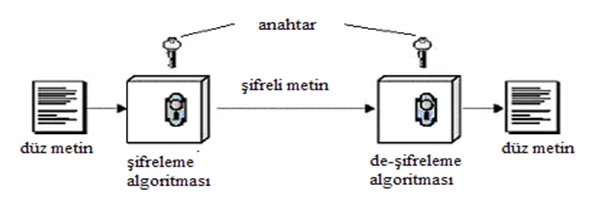
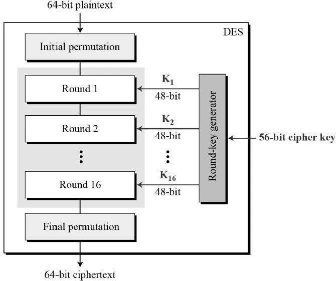
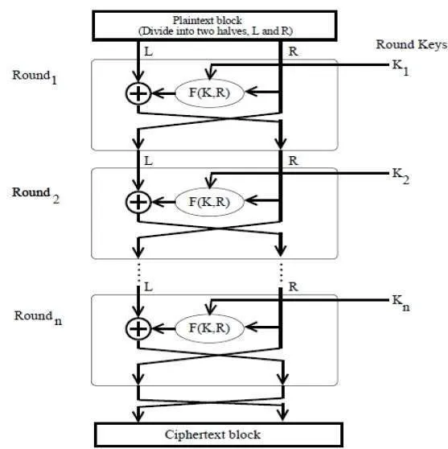
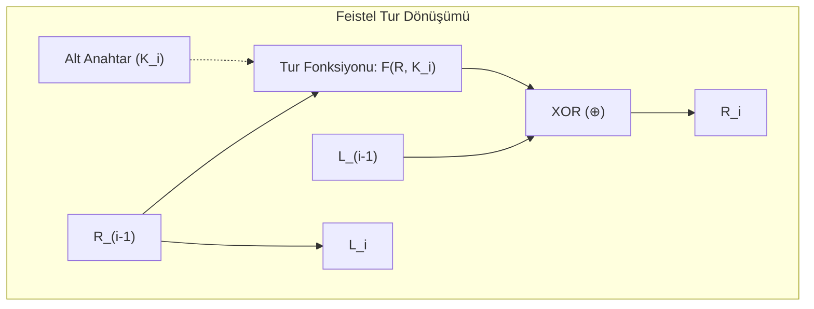

Blok şifreleyiciler (*Block Ciphers*), açık metni sabit uzunluktaki bloklara (örneğin 64 bit veya 128 bit) bölerek her bloğu gizli bir anahtar kontrolünde aynı boyutta bir şifreli blokla eşleştiren deterministik permütasyonlardır.

---

## 1. Teorik Sezgi & Matematik



Modern blok şifreleyiciler Claude Shannon'ın ortaya koyduğu iki temel ilkeye dayanır:
* **Karışıklık (Confusion):** Şifreli metin ile anahtar arasındaki ilişkiyi olabildiğince karmaşık ve doğrusal olmayan hale getirmek (S-Box yapıları).
* **Yayılma (Diffusion):** Açık metindeki tek bir bitin değişiminin şifreli metindeki tüm bitlerin yaklaşık yarısını değiştirmesini sağlamak (Çığ Etkisi - *Avalanche Effect*).

### 1. Feistel Ağı (DES / 3DES Mimarisi)



Horst Feistel tarafından IBM'de geliştirilen bu yapıda blok iki eşit yarıya bölünür ($L$ ve $R$). $r$ tur boyunca şu dönüşüm uygulanır:

$$L_i = R_{i-1}$$
$$R_i = L_{i-1} \oplus F(R_{i-1}, K_i)$$



**Feistel Ağının Zarif Avantajı:** 
Tur fonksiyonu olan $F$'in matematiksel olarak tersinir (*invertible*) olması gerekmez! Deşifre işlemi için aynı devre kullanılır; sadece alt anahtarlar ($K_r, \dots, K_1$) tersten beslenir.



### 2. SPN Mimarisi (Substitution-Permutation Network)

Modern AES algoritmasının da temelini oluşturan SPN, Feistel gibi bloğu bölmez; tüm bloğa eşzamanlı turlar uygular:
1. **Key Addition (Tur Anahtarı Ekleme):** Durum matrisinin tur anahtarıyla XOR'lanması.
2. **Substitution (S-Box):** Baytların doğrusal olmayan tablolarla değiştirilmesi (*Confusion*).
3. **Permutation (P-Box / MixColumns):** Bitlerin/baytların konumlarının dağıtılması (*Diffusion*).

> **SPN Şartı:** Feistel'den farklı olarak, SPN'de kullanılan tüm S-Box ve Permütasyon fonksiyonları **kesinlikle birebir ve örten (tersinir)** olmak zorundadır.

---

## 2. Gerçek Hayat Mimarisi: DES'in Çöküşü ve 3DES

* **DES (Data Encryption Standard):** 1977'de 56-bit anahtar uzunluğuyla standartlaştırıldı. 1998'de EFF (*Electronic Frontier Foundation*), özel inşa ettiği "Deep Crack" donanımıyla bir DES anahtarını 56 saatte kaba kuvvetle çözdü.
* **Double-DES Neden Kullanılamaz? (Meet-in-the-Middle):** İki kez DES şifrelemesi ($C = E_{K_2}(E_{K_1}(P))$) anahtar uzayını $2^{112}$'ye çıkarmaz. Saldırgan ortada buluşma tekniğiyle bir taraftan şifrelerken diğer taraftan deşifre edip hash tablosunda eşleştirerek sistemi $2^{57}$ işlemde çözer.
* **Triple-DES (3DES / EDE):** Çözüm olarak $C = E_{K_1}(D_{K_2}(E_{K_3}(P)))$ mimarisi kullanılmıştır. Günümüzde Sweet32 atağı (64-bit blok boyutu çarpışmaları) nedeniyle kullanımdan kaldırılmıştır.

---

## 3. Uygulamalı Kod Örneği: Python ile Minimal Feistel Ağı Simülasyonu

```python
def round_function(r_half: int, round_key: int) -> int:
    """Doğrusal olmayan tur fonksiyonu F (Basit model)."""
    return ((r_half * 31) ^ (round_key << 2)) & 0xFFFF

def feistel_encrypt(block: int, keys: list) -> int:
    """32-bitlik bloğu (16-bit L, 16-bit R) Feistel ağıyla şifreler."""
    left = (block >> 16) & 0xFFFF
    right = block & 0xFFFF

    for k in keys:
        new_left = right
        f_out = round_function(right, k)
        new_right = left ^ f_out
        left, right = new_left, new_right

    # Son tur takası geri alınır ve birleştirilir
    return (right << 16) | left

def feistel_decrypt(cipher_block: int, keys: list) -> int:
    """Feistel deşifreleme: Aynı kod, sadece anahtarlar ters sırada uygulanır!"""
    return feistel_encrypt(cipher_block, list(reversed(keys)))

# Test
round_keys = [0xA1B2, 0xC3D4, 0xE5F6, 0x1234]
plaintext_block = 0x1337BEEF

cipher_block = feistel_encrypt(plaintext_block, round_keys)
recovered_block = feistel_decrypt(cipher_block, round_keys)

print(f"[+] Açık Blok    : 0x{plaintext_block:08X}")
print(f"[+] Şifreli Blok : 0x{cipher_block:08X}")
print(f"[+] Çözülen Blok : 0x{recovered_block:08X}")
assert plaintext_block == recovered_block
```

---

## 4. Güvenlik & Kriptanaliz Notu

:::danger[Sweet32 Zafiyeti (CVE-2016-2183): 64-bit Blok Boyutunun Sonu]
Doğum Günü Paradoksu gereği, $n$-bit blok boyutuna sahip bir şifreleyicide yaklaşık $2^{n/2}$ blok şifrelendikten sonra iki farklı açık metin bloğunun aynı şifreli bloğu üretme (çarpışma) olasılığı %50'ye ulaşır. 
DES ve Blowfish gibi 64-bit blok kullanan sistemlerde $2^{32}$ blok ($\approx 32\text{ GB}$) veri aktarıldığında çarpışmalar oluşur ve oturum çerezleri ele geçirilebilir. Bu nedenle **modern standart blok boyutu en az 128 bit (AES)** olmak zorundadır.
:::

