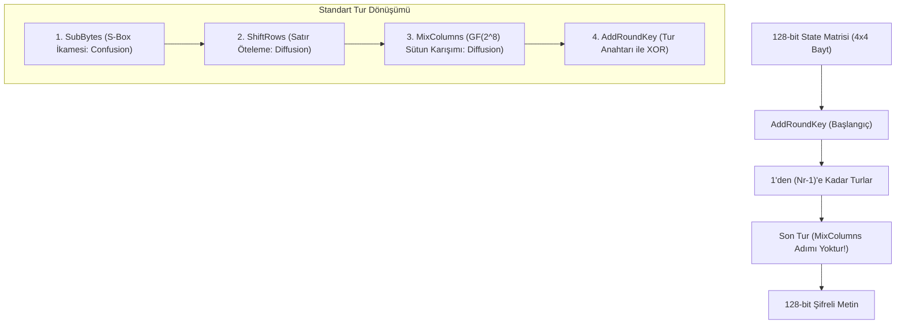
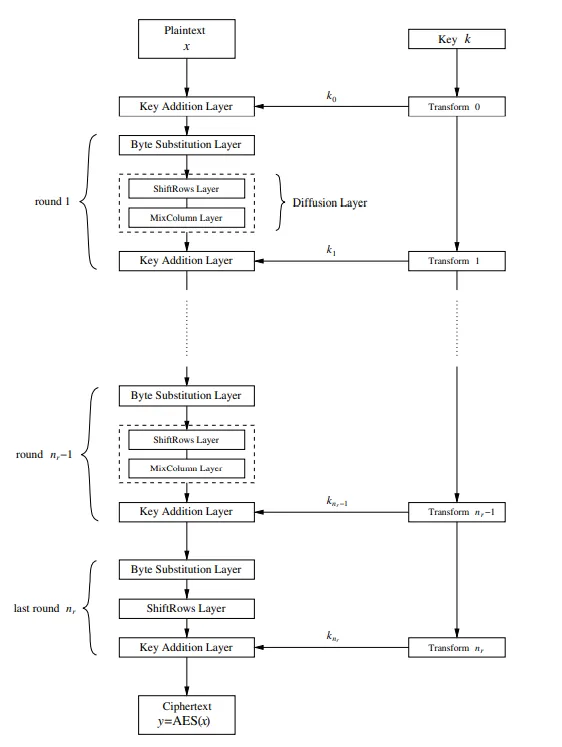

1997 yılında NIST tarafından açılan yarışmayı kazanan Belçikalı kriptograflar Joan Daemen ve Vincent Rijmen'in geliştirdiği **Rijndael** algoritması, 2001 yılında **AES (Advanced Encryption Standard)** olarak kabul edilmiştir ve günümüzde küresel şifreleme standardıdır.

---

## 1. Teorik Sezgi & Matematik

AES, 128-bitlik (16 bayt) verileri $4 \times 4$'lük bir bayt matrisi (**State Matrisi**) olarak işler. Anahtar uzunluğuna göre tur sayısı değişir:
* **AES-128:** 10 Tur (128-bit anahtar)
* **AES-192:** 12 Tur (192-bit anahtar)
* **AES-256:** 14 Tur (256-bit anahtar)

### Galois Alanı $GF(2^8)$ Matematiği

AES'teki tüm bayt işlemleri, 8-bitlik sonlu alan olan $\mathbb{F}_{2^8} = GF(2^8)$ üzerinde yürütülür. 
* Bir bayt, katsayıları $\{0, 1\}$ olan 7. dereceden bir polinomdur: 
  $$b_7 x^7 + b_6 x^6 + \dots + b_1 x + b_0$$
* **Toplama:** İki polinomun mod 2 katsayı toplamıdır, yani basitçe **XOR ($\oplus$)** işlemidir.
* **Çarpma:** Standart polinom çarpımı yapıldıktan sonra AES'in standart **indirgenemez polinomuna (*irreducible polynomial*)** bölünerek kalan alınır:
  $$m(x) = x^8 + x^4 + x^3 + x + 1 \quad (\text{Hex: } 0\text{x}11\text{B})$$



### 4 Ana Tur Dönüşümü



1. **SubBytes (İkame):** Durum matrisindeki her bayt, $GF(2^8)$ içinde çarpımsal tersi alınıp $\mathbb{F}_2$ üzerinde bir afin dönüşümden geçirilerek S-Box tablosundaki karşılığıyla değiştirilir. Diferansiyel ve lineer kriptanalize karşı maksimum direnç sağlar.
2. **ShiftRows (Satır Kaydırma):** Matrisin 0. satırı sabit kalır; 1. satır 1 bayt, 2. satır 2 bayt, 3. satır 3 bayt sola dairesel ötelenir.
3. **MixColumns (Sütun Karıştırma):** Her sütun, $GF(2^8)$ üzerinde sabit bir MDS matrisi ile çarpılır. Tek bir bayttaki değişimi sonraki turda 4 bayta birden yayar.
4. **AddRoundKey (Anahtar Ekleme):** O anki turun 128-bitlik alt anahtarı (Key Schedule ile türetilmiş) State matrisi ile XOR'lanır.

---

## 2. Gerçek Hayat Mimarisi: Donanım Hızlandırması (AES-NI)

Yazılımsal olarak S-Box tabloları aramak (*lookup table*) önbellek zamanlama saldırılarına (*cache-timing attacks*) gebedir. Bu nedenle modern Intel ve AMD işlemcilerde **AES-NI** komut kümesi (örneğin `AESENC`, `AESDEC`, `AESKEYGENASSIST`) bulunur. Bu talimatlar AES turlarını doğrudan CPU silikonunda, **sabit zamanda (constant-time)** ve döngü başına 1 saat çevriminden daha kısa sürede çalıştırır.

---

## 3. Uygulamalı Kod Örneği: Python ile $GF(2^8)$ Çarpımı (xtime Algoritması)

$GF(2^8)$ alanında bir baytı $x$ (yani $2$) ile çarpmak bir bit sola kaydırma işlemidir. Eğer en sol bit (MSB) `1` ise, taşmayı önlemek için $0x11B$ ile modüler XOR yapılır (`xtime`):

```python
def xtime(b: int) -> int:
    """GF(2^8)'de 2 ({02}) ile çarpma işlemi."""
    if b & 0x80:
        return ((b << 1) ^ 0x11B) & 0xFF
    return (b << 1) & 0xFF

def gf_multiply(a: int, b: int) -> int:
    """GF(2^8) alanında iki baytın Russian Peasant algoritmasıyla çarpımı."""
    res = 0
    temp_a = a
    for _ in range(8):
        if b & 1:
            res ^= temp_a
        temp_a = xtime(temp_a)
        b >>= 1
    return res

# MixColumns işlemindeki sabit katsayılarla test:
# AES MDS matrisinde 0x57 baytının {02} ve {03} ile çarpımı
val = 0x57
mul2 = xtime(val)               # val * 0x02
mul3 = mul2 ^ val               # val * 0x03 = (val * 0x02) ^ val

print(f"[+] 0x{val:02X} * 0x02 mod GF(2^8) = 0x{mul2:02X} (Beklenen: 0xAE)")
print(f"[+] 0x{val:02X} * 0x03 mod GF(2^8) = 0x{mul3:02X} (Beklenen: 0xF9)")
assert mul2 == 0xAE and mul3 == 0xF9
```

---

## 4. Güvenlik & Kriptanaliz Notu

:::note[Neden Son Turda MixColumns Yoktur?]
Deşifreleme işleminin şifreleme algoritmasıyla tamamen aynı mimari yapıda (*Equivalent Inverse Cipher*) yürütülebilmesi için AES tasarımcıları son turdaki MixColumns adımını kasten çıkarmıştır. Bu sayede donanım tasarımcıları aynı mantık kapılarını hem şifreleme hem de deşifreleme için minimum silikon alanıyla kullanabilmektedir.
:::

