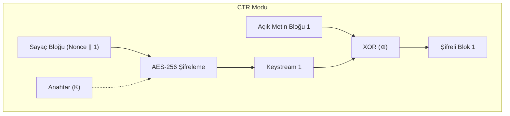

Bir blok şifreleyici tek başına yalnızca 16 baytlık tek bir bloğu şifreleyebilir. Terabaytlarca veriyi şifrelemek için blokların birbirine nasıl bağlanacağını belirleyen **Çalışma Modları (*Modes of Operation*)** devreye girer.

---

## 1. Teorik Sezgi & Matematik

### 1. ECB (Electronic Codebook) - Kullanılması Yasaklanan Mod

Her 16 baytlık blok bağımsız olarak aynı anahtarla şifrelenir: $C_i = E_K(P_i)$.
* **Ölümcül Kusur:** Aynı açık metin bloğu daima aynı şifreli bloğu üretir. Ünlü *"Linux Pengueni Tux"* görseli ECB ile şifrelendiğinde renkler değişir ancak penguenin silüeti ve tüm desenleri apaçık ortada kalır! Veri desenlerini gizleyemez.

### 2. CBC (Cipher Block Chaining)

Her açık metin bloğu, şifrelenmeden önce bir önceki şifreli blokla XOR'lanır. İlk blok için rastgele bir **Başlatma Vektörü (IV)** kullanılır:

$$C_0 = IV$$
$$C_i = E_K(P_i \oplus C_{i-1})$$

* **Sorun:** Bloklar birbirine bağımlı olduğu için şifreleme işlemi paralelleştirilemez. Ayrıca bütünlük koruması sağlamaz (Bit-flipping ve Padding Oracle açıklarına açıktır).

### 3. CTR (Counter Mode)

Blok şifreleyiciyi yüksek hızlı bir akış şifreleyiciye dönüştürür. Her blok için bir sayaç artırılır ($Nonce \parallel Counter$), bu sayaç şifrelenerek anahtar akışı elde edilir ve açık metinle XOR'lanır:

$$C_i = P_i \oplus E_K(Nonce \parallel i)$$

* **Avantaj:** Tamamen paralelleştirilebilir, rastgele erişim (*random read/write*) imkanı sunar ve dolgu (*padding*) gerektirmez.



### 4. AEAD (Authenticated Encryption with Associated Data)

Yalnızca gizlilik (*Confidentiality*) yetersizdir; saldırgan şifreli metin üzerindeki bitleri manipüle edebilir. **AEAD**, veriyi şifrelerken aynı anda bir kriptografik kimlik doğrulama etiketi (**Authentication Tag**) üretir:
* **AES-GCM (Galois/Counter Mode):** CTR modu şifrelemesi ile $GF(2^{128})$ sonlu alanında çalışan yüksek hızlı **GHASH** fonksiyonunu birleştirir.
* **ChaCha20-Poly1305:** ChaCha20 akış şifresi ile Poly1305 MAC algoritmasının birleşimidir.

---

## 2. Gerçek Hayat Mimarisi

* **TLS 1.3 ve HTTP/2:** TLS 1.3 standardında tüm eski modlar (CBC, RC4, 3DES) tamamen yasaklanmıştır. Yalnızca AEAD şifre süitlerine izin verilir: `AES_128_GCM_SHA256`, `AES_256_GCM_SHA384`, `CHACHA20_POLY1305_SHA256`.
* **Ağ Paket Başlıkları (AAD):** Bir ağ paketinin IP başlığı şifrelenemez (yönlendiricilerin okuması gerekir), ancak değiştirilmemesi şarttır. Bu açık başlıklar AEAD'ye **İlişkili Veri (AAD)** olarak verilir; başlıkta tek bir bit bile değişirse tüm paket reddedilir.

---

## 3. Uygulamalı Kod Örneği: Go ile AES-GCM (AEAD) Şifreleme ve AAD Doğrulama

```go
package main

import (
	"crypto/aes"
	"crypto/cipher"
	"crypto/rand"
	"fmt"
	"io"
)

func main() {
	// 256-bit AES anahtarı
	key := make([]byte, 32)
	if _, err := io.ReadFull(rand.Reader, key); err != nil {
		panic(err)
	}

	block, err := aes.NewCipher(key)
	if err != nil {
		panic(err)
	}

	// GCM modunda AEAD sarmalayıcısı
	gcm, err := cipher.NewGCM(block)
	if err != nil {
		panic(err)
	}

	// 96-bit standart GCM Nonce
	nonce := make([]byte, gcm.NonceSize())
	if _, err := io.ReadFull(rand.Reader, nonce); err != nil {
		panic(err)
	}

	plaintext := []byte("Hassas Kredi Karti Verisi: 4543-XXXX-XXXX-1234")
	aadHeader := []byte("UserID:10442|Role:Admin") // Açık kalan ama kurcalanamaz başlık

	// Şifreleme ve Etiket Üretimi (Seal)
	ciphertext := gcm.Seal(nil, nonce, plaintext, aadHeader)
	fmt.Printf("[+] Şifreli Metin + Tag (%d Bayt): %x\n", len(ciphertext), ciphertext)

	// Başarılı Deşifreleme (Open)
	decrypted, err := gcm.Open(nil, nonce, ciphertext, aadHeader)
	if err != nil {
		panic("Doğrulama başarısız!")
	}
	fmt.Printf("[✓] Çözülen Metin: %s\n", string(decrypted))

	// Saldırı Simülasyonu: Saldırgan AAD başlığını manipüle ederse:
	fakeAAD := []byte("UserID:10442|Role:Root")
	_, err = gcm.Open(nil, nonce, ciphertext, fakeAAD)
	if err != nil {
		fmt.Printf("[!] Beklenen Güvenlik Uyarısı: %v (Paket sahteciliği engellendi!)\n", err)
	}
}
```

---

## 4. Güvenlik & Kriptanaliz Notu

> [!CAUTION]
> **AES-GCM'de Nonce Tekrarı Felaketi: The "Forbidden Attack"**
> AES-GCM'de aynı anahtarla aynı Nonce değeri iki kez kullanılırsa; saldırgan basit bir sonlu alan cebiriyle ($GF(2^{128})$ üzerinde iki etiket arasındaki farkı çözerek) **gizli GHASH kimlik doğrulama anahtarını ($H$) tamamen elde eder**.
> Bu anahtar ele geçirildiğinde saldırgan dilediği gibi sahte şifreli metinler ve geçerli etiketler üretebilir; sistemin tüm bütünlüğü çöker. Nonce yönetiminde sayaç kullanılmalı ya da **AES-GCM-SIV** (sentetik IV - Nonce misuse-resistant) tercih edilmelidir.

