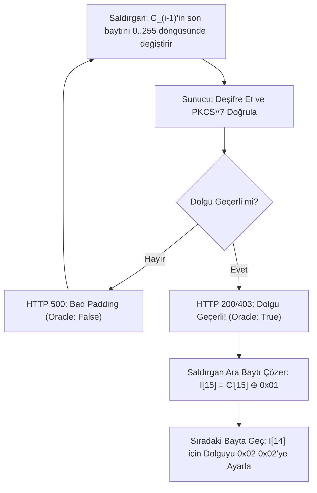

2002 yılında İsviçreli kriptograf **Serge Vaudenay**, kriptografi tarihinin en yıkıcı pratik saldırılarından birini yayınladı: **Padding Oracle Attack**. Bu saldırı, şifreleme algoritması (AES) matematiksel olarak kusursuz olsa bile, sunucunun dolgu hatalarına verdiği tepkilerden anahtar bilinmeden tüm verinin bayt bayt deşifre edilebileceğini kanıtlamıştır.

---

## 1. Teorik Sezgi & Matematik

### PKCS#7 Dolgu Standardı (Padding)

128-bitlik (16 bayt) blok şifreleyicilerde verinin son bloğu 16 bayttan kısa ise kalan kısım eksik bayt sayısı kadar bayt değeriyle doldurulur:
* 1 bayt eksikse: `0x01`
* 2 bayt eksikse: `0x02 0x02`
* 5 bayt eksikse: `0x05 0x05 0x05 0x05 0x05`
* Tam 16 baytsa: 16 baytlık yeni bir dolgu bloğu eklenir (`0x10` x 16).

### CBC Deşifreleme Denklemi

$$P_i = D_K(C_i) \oplus C_{i-1}$$

Burada $I_i = D_K(C_i)$ ara durum değeridir (*Intermediate State*). Eğer saldırgan bir önceki şifreli bloğu ($C_{i-1}$) manipüle ederse, sunucunun deşifre ettiği açık metin bloğunu ($P_i$) doğrudan kontrol eder.

### Oracle Mantığı

Sunucu şifreli bir veriyi aldığında iki farklı hata üretebilir:
1. **Dolgu Hatası (Padding Error):** Son baytlar geçerli bir PKCS#7 dizilimi oluşturmuyor.
2. **Uygulama Hatası (Format/Auth Error):** Dolgu doğru açıldı ancak veri anlamsız.

Saldırgan $C_{i-1}$'in son baytını $0$'dan $255$'e kadar değiştirerek sunucuya gönderir. Sunucu ne zaman "Dolgu Doğru" derse, saldırgan son açık metin baytının $0x01$ olduğunu kesinleştirir:

$$I_i[15] = C'_{i-1}[15] \oplus 0\text{x}01$$
$$P_i[15] = I_i[15] \oplus C_{i-1}[15]$$

Bu işlem geriye doğru 16 bayt boyunca tekrarlanarak bloğun tamamı tek tek okunur.



---

## 2. Gerçek Hayat Mimarisi

* **POODLE Saldırısı (CVE-2014-3566):** SSL 3.0 protokolündeki gevşek CBC dolgu kurallarını istismar ederek web oturum çerezlerini ele geçiren bir Padding Oracle türevidir. Bu açık SSL 3.0'ın tamamen tarihe karışmasına yol açmıştır.
* **ASP.NET Padding Oracle (MS10-070):** Microsoft'un ASP.NET web formlarında oturum ve viewstate verilerinin bu yöntemle ele geçirilip sunucularda uzaktan kod yürütülmesine (RCE) imkan tanımıştır.

---

## 3. Uygulamalı Kod Örneği: Python ile Tam Padding Oracle Exploit Simülasyonu

```python
import os

# Basitleştirilmiş Simülasyon Modeli
class VulnerableServer:
    def __init__(self, key: bytes):
        self._key = key

    def _dummy_decrypt(self, block: bytes) -> bytes:
        # Gerçek AES yerine tersinir basit bir ara durum dönüşümü (Model)
        return bytes((b ^ 0x5A) for b in block)

    def padding_oracle(self, iv: bytes, ciphertext: bytes) -> bool:
        """Sunucu yalnızca dolgunun geçerli olup olmadığını dışarı sızdırır (Oracle)."""
        # C_1 bloğunu deşifre et ve IV ile XOR'la: P = D(C) ^ IV
        intermediate = self._dummy_decrypt(ciphertext)
        plaintext = bytes(i ^ v for i, v in zip(intermediate, iv))
        
        # PKCS#7 Doğrulama
        pad_len = plaintext[-1]
        if pad_len < 1 or pad_len > 16:
            return False
        return plaintext[-pad_len:] == bytes([pad_len] * pad_len)


def exploit_padding_oracle(server: VulnerableServer, iv: bytes, ciphertext_block: bytes) -> bytes:
    """Anahtarı bilmeden şifreli bloğu bayt bayt çözen saldırı kodu."""
    block_size = 16
    intermediate = [0] * block_size
    recovered_plaintext = [0] * block_size

    # 15. bayttan 0. bayta doğru geriye doğru saldırı
    for byte_pos in range(block_size - 1, -1, -1):
        target_pad = block_size - byte_pos
        attack_iv = [0] * block_size

        # Önceden çözülen baytları hedef dolguya eşitle
        for k in range(byte_pos + 1, block_size):
            attack_iv[k] = intermediate[k] ^ target_pad

        found = False
        for guess in range(256):
            attack_iv[byte_pos] = guess
            if server.padding_oracle(bytes(attack_iv), ciphertext_block):
                intermediate[byte_pos] = guess ^ target_pad
                recovered_plaintext[byte_pos] = intermediate[byte_pos] ^ iv[byte_pos]
                found = True
                break

        if not found:
            raise RuntimeError(f"{byte_pos}. bayt çözülemedi!")

    return bytes(recovered_plaintext)


# Test
secret_key = os.urandom(16)
server = VulnerableServer(secret_key)

# 16 baytlık hedef blok (13 bayt metin + 3 bayt PKCS#7 dolgu: 0x03 0x03 0x03)
original_plain = b"GIZLI_PAROLA" + bytes([4] * 4)
original_iv = os.urandom(16)
# Şifreli metin: C = E(P ^ IV) -> D(C) = P ^ IV
intermediate_expected = bytes(p ^ v for p, v in zip(original_plain, original_iv))
cipher_block = bytes(b ^ 0x5A for b in intermediate_expected)

print("[*] Padding Oracle Saldırısı Başlatılıyor...")
cracked = exploit_padding_oracle(server, original_iv, cipher_block)
print(f"[✓] Çözülen Orijinal Blok: {cracked}")
print(f"[✓] Dolgusu Temizlenmiş Metin: {cracked[:-cracked[-1]].decode()}")
```

---

## 4. Güvenlik & Kriptanaliz Notu

> [!CAUTION]
> **Tek Kesin Çözüm: Encrypt-then-MAC veya AEAD**
> Padding Oracle saldırısını önlemenin yolu hata mesajlarını gizlemek veya zamanlama farklarını eşitlemek değildir (zamanlama yan kanalları yine de sızdırır). 
> **Kesin Çözüm:** Deşifre işlemine başlamadan önce şifreli metnin bütünlüğünü doğrulamaktır (*Encrypt-then-MAC*). 
> Eğer veri manipüle edilmişse deşifre fonksiyonu ve dolgu açma mantığı asla çalıştırılmamalıdır. Modern standart **AES-GCM** veya **ChaCha20-Poly1305 (AEAD)** kullanıldığında bu saldırı sınıfı kökten imkansız hale gelir.
