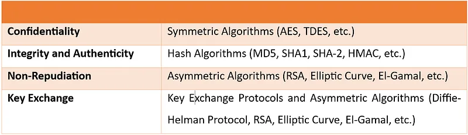
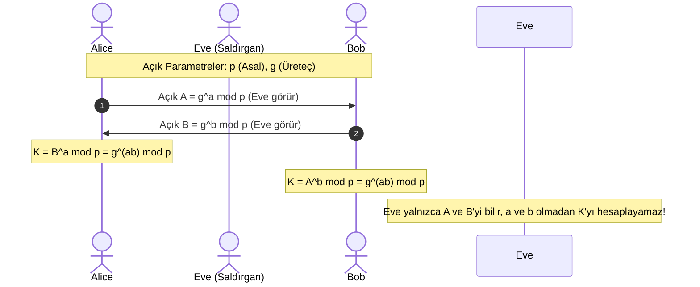

1976 yılında Whitfield Diffie ve Martin Hellman tarafından yayınlanan *“New Directions in Cryptography”* makalesi, birbirini hiç tanımayan ve tamamen güvensiz bir kanal üzerinden konuşan iki tarafın ortak bir gizli anahtar üzerinde anlaşabileceğini göstererek asimetrik kriptografi çağını başlatmıştır.

---

## 1. Teorik Sezgi & Matematik


Diffie-Hellman, bir şifreleme algoritması değil; bir **Anahtar Değişim Protokolüdür**.

### Protokol Adımları



1. **Açık Parametreler:** Alice ve Bob herkesin görebileceği büyük bir $p$ asalı ve bir $g$ üreteci (*generator*) seçer ($g < p$).
2. **Gizli Değerler:**
   * Alice rastgele gizli bir sayı seçer: $a \in [2, p-2]$
   * Bob rastgele gizli bir sayı seçer: $b \in [2, p-2]$
3. **Açık Değerlerin Paylaşımı:**
   * Alice açık anahtarını hesaplar ve gönderir: $A = g^a \pmod{p}$
   * Bob açık anahtarını hesaplar ve gönderir: $B = g^b \pmod{p}$
4. **Ortak Simetrik Anahtarın Hesaplanması:**
   * Alice hesaplar: $K = B^a \pmod{p} = (g^b)^a \equiv g^{ab} \pmod{p}$
   * Bob hesaplar: $K = A^b \pmod{p} = (g^a)^b \equiv g^{ab} \pmod{p}$

Kanalı dinleyen bir saldırgan ($E$), yalnızca $p, g, A, B$ değerlerini görür. $g^{ab} \pmod{p}$ değerini bu açık parametrelerden hesaplamak **Hesaplamalı Diffie-Hellman (CDH)** problemidir ve Ayrık Logaritma Problemi (DLP) çözülmeden imkansızdır.



### Kimlik Doğrulama Eksikliği ve Ortadaki Adam (MitM)

Diffie-Hellman tek başına tarafların kimliğini doğrulamaz (*Unauthenticated*). Eğer bir saldırgan (Eve/Mallory) ağ trafiğini yönlendirebiliyorsa:
* Alice'e kendisini Bob gibi tanıtır ve kendi $g^{e_1}$ değerini verir.
* Bob'a kendisini Alice gibi tanıtır ve kendi $g^{e_2}$ değerini verir.
* İki ayrı tünel kurarak aradaki tüm iletişimi şifresiz okur ve değiştirir.
* **Çözüm:** Açık anahtarların bir Dijital İmza (ECDSA/Ed25519) veya Sertifika (X.509) ile imzalanması şarttır.

### Mükemmel İleri Gizlilik (Perfect Forward Secrecy - PFS)

* **Statik Anahtar Değişimi:** Eğer sunucunun sabit açık anahtarıyla oturum anahtarları şifrelenirse; gelecekte sunucunun uzun vadeli gizli anahtarı çalındığında, saldırgan geçmişe dönük kaydettiği tüm şifreli ağ trafiğini (*Store Now, Decrypt Later*) çözebilir.
* **Efemeral Diffie-Hellman (DHE / ECDHE):** Her yeni oturum için tek kullanımlık (*ephemeral*) $a$ ve $b$ sayıları üretilir ve oturum biter bitmez RAM'den silinir. Gelecekte anahtarlar çalınsa bile geçmiş oturumlar asla deşifre edilemez (**PFS**).

---

## 2. Gerçek Hayat Mimarisi

* **TLS 1.3:** TLS 1.3 standardında statik RSA anahtar değişimi tamamen yasaklanmış, yalnızca **ECDHE (Eliptik Eğri Efemeral Diffie-Hellman)** zorunlu kılınmıştır.
* **Uçtan Uca Şifreli Mesajlaşma (Signal / WhatsApp):** Her mesajda yeni bir efemeral anahtar türeten **Double Ratchet** algoritması, Diffie-Hellman mekanizmasının anlık olarak tekrarlanmasına dayanır.

---

## 3. Uygulamalı Kod Örneği: Python ile Diffie-Hellman Simülasyonu

```python
import os

# RFC 3526 - Modüler Üs Grubu (Örnek küçük asal ve üreteç)
PRIME_P = 0xFFFFFFFFFFFFFFFFC90FDAA22168C234C4C6628B80DC1CD129024E088A67CC74020BBEA63B139B22514A08798E3404DDEF9519B3CD3A431B302B0A6DF25F14374FE1356D6D51C245E485B576625E7EC6F44C42E9A637ED6B0BFF5CB6F406B7EDEE386BFB5A899FA5AE9F24117C4B1FE649286651ECE45B3DC2007CB8A163BF0598DA48361C55D39A69163FA8FD24CF5F83655D23DCA3AD961C62F356208552BB9ED529077096966D670C354E4ABC9804F1746C08CA18217C32905E462E36CE3BE39E772C180E86039B2783A2EC07A28FB5C55DF06F4C52C9DE2BCBF6955817183995497CEA956AE515D2261898FA051015728E5A8AACAA68FFFFFFFFFFFFFFFF
GENERATOR_G = 2

def generate_private_key():
    return int.from_bytes(os.urandom(32), 'big')

# 1. Alice ve Bob gizli anahtarlarını üretir
alice_priv = generate_private_key()
bob_priv = generate_private_key()

# 2. Açık anahtarlar hesaplanır
alice_pub = pow(GENERATOR_G, alice_priv, PRIME_P)
bob_pub = pow(GENERATOR_G, bob_priv, PRIME_P)

# 3. Ortak Simetrik Anahtarın Türetilmesi
alice_shared = pow(bob_pub, alice_priv, PRIME_P)
bob_shared = pow(alice_pub, bob_priv, PRIME_P)

print(f"[+] Alice Ortak Anahtar Özeti : {hex(alice_shared)[:30]}...")
print(f"[+] Bob Ortak Anahtar Özeti   : {hex(bob_shared)[:30]}...")
assert alice_shared == bob_shared
print("[✓] Diffie-Hellman Ortak Anahtarı Başarıyla Eşleşti!")
```

---

## 4. Güvenlik & Kriptanaliz Notu

:::caution[Logjam Saldırısı (CVE-2015-4000): Zayıf Grup Parametreleri]
2015 yılında keşfedilen Logjam saldırısında, binlerce web ve VPN sunucusunun aynı standart 1024-bitlik Diffie-Hellman asalını ($p$) paylaştığı ortaya çıkmıştır. Saldırganlar (özellikle devlet destekli aktörler) bu tek asal için aylar süren bir ön hesaplama (*precomputation*) yaparak, bu asalı kullanan tüm oturumları dakikalar içinde deşifre etmiştir.
**Kural:** Klasik DH için en az **2048-bit veya 3072-bit** asallar kullanılmalı ya da standart olarak **Eliptik Eğri Diffie-Hellman (X25519)** mimarisine geçilmelidir.
:::

