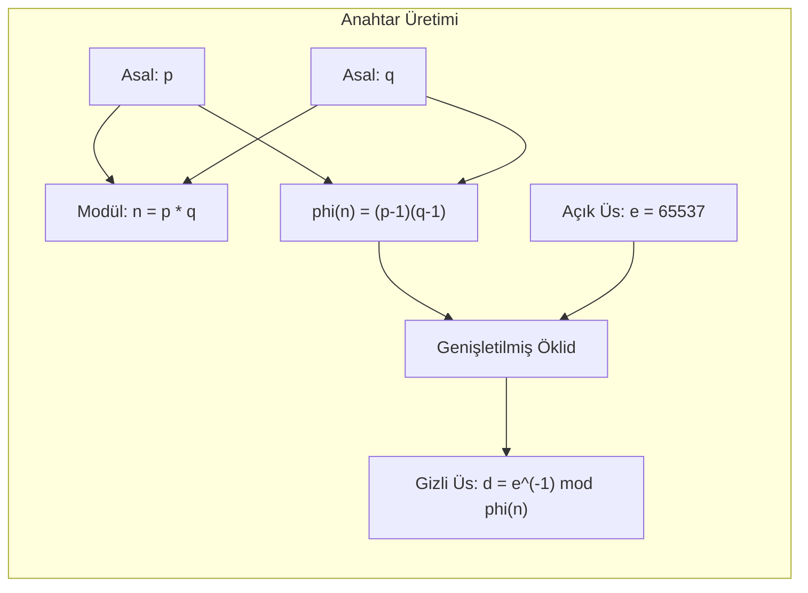

1977 yılında MIT'de Ron Rivest, Adi Shamir ve Leonard Adleman tarafından geliştirilen **RSA**, hem açık anahtarlı şifreleme hem de dijital imza yeteneğine sahip ilk pratik algoritmadır. Güvenliği, büyük tam sayıların asal çarpanlarına ayrılmasının (*Integer Factorization Problem*) hesaplama zorluğuna dayanır.

---

## 1. Teorik Sezgi & Matematik

### Anahtar Üretim Süreci

1. **Asal Seçimi:** İki adet çok büyük ve gizli asal sayı seçilir: $p$ ve $q$ (örneğin her biri 1024 bit).
2. **Modülün Hesaplanması:** 
   $$n = p \cdot q$$
   $n$, açık anahtarın boyutunu (2048 bit) belirleyen modüldür ve herkese açıktır.
3. **Euler Totient Fonksiyonu:**
   $$\phi(n) = (p - 1)(q - 1)$$
4. **Açık Üs ($e$):** $\gcd(e, \phi(n)) = 1$ ve $1 < e < \phi(n)$ olacak şekilde seçilir.
   * Standart endüstri tercihi: $e = 65537$ ($2^{16} + 1$, ikili tabanda sadece iki adet 1 biti içerdiğinden modüler üs almayı son derece hızlandırır).
5. **Gizli Üs ($d$):** Genişletilmiş Öklid algoritmasıyla $e$'nin $\phi(n)$ modundaki tersi alınır:
   $$d \equiv e^{-1} \pmod{\phi(n)} \iff e \cdot d \equiv 1 \pmod{\phi(n)}$$

* **Açık Anahtar (*Public Key*):** $(n, e)$
* **Gizli Anahtar (*Private Key*):** $(n, d)$ veya $(p, q, d)$

### Şifreleme ve Deşifreleme

* **Şifreleme:** $c \equiv m^e \pmod{n}$
* **Deşifreleme:** $m \equiv c^d \pmod{n}$

**Matematiksel Doğrulama (Euler Teoremi):**
$$c^d \equiv (m^e)^d \equiv m^{e \cdot d} \equiv m^{k \cdot \phi(n) + 1} \equiv (m^{\phi(n)})^k \cdot m \equiv 1^k \cdot m \equiv m \pmod{n}$$



---

## 2. Gerçek Hayat Mimarisi: Textbook RSA Neden Yasaktır?

Matematiksel formülü doğrudan koda dökmek (**"Textbook RSA"**) ölümcül güvenlik açıklarına yol açar:
1. **Deterministik Şifreleme:** Aynı mesaj her zaman aynı şifreli metni üretir. Saldırgan olası mesajları (örneğin *"EVET"* / *"HAYIR"*) açık anahtarla şifreleyerek karşılaştırabilir.
2. **Çarpımsal Homomorfizm:** 
   $$E(m_1) \cdot E(m_2) \equiv m_1^e \cdot m_2^e \equiv (m_1 \cdot m_2)^e \equiv E(m_1 \cdot m_2) \pmod{n}$$
   Saldırgan anahtarı bilmeden iki şifreli metni çarparak açık metinlerin çarpımını temsil eden geçerli bir şifreli metin üretebilir.

### Çözüm: PKCS#1 v2.2 OAEP (Optimal Asymmetric Encryption Padding)

Modern RSA şifrelemesinde açık metin, şifrelenmeden önce iki rastgele özet fonksiyonundan geçirilen Feistel benzeri bir **OAEP** zırhına sarılır. OAEP; şifrelemeyi olasılıksal (*probabilistic*) hale getirir, determinizmi ve homomorfik manipülasyonları imkansız kılar.

---

## 3. Uygulamalı Kod Örneği: Go ile RSA-OAEP Şifreleme

```go
package main

import (
	"crypto/rand"
	"crypto/rsa"
	"crypto/sha256"
	"fmt"
)

func main() {
	// 1. 2048-bit RSA Anahtar Çifti Üretimi
	privateKey, err := rsa.GenerateKey(rand.Reader, 2048)
	if err != nil {
		panic(err)
	}
	publicKey := &privateKey.PublicKey

	message := []byte("Gizli Veri: RSA-OAEP ile Guvende")
	label := []byte("Oturum-101") // İsteğe bağlı etiket

	// 2. OAEP Dolgusu ile Güvenli Şifreleme
	hash := sha256.New()
	ciphertext, err := rsa.EncryptOAEP(hash, rand.Reader, publicKey, message, label)
	if err != nil {
		panic(err)
	}
	fmt.Printf("[+] RSA-OAEP Şifreli Metin (%d Bayt): %x...\n", len(ciphertext), ciphertext[:32])

	// 3. Güvenli Deşifreleme
	decrypted, err := rsa.DecryptOAEP(hash, rand.Reader, privateKey, ciphertext, label)
	if err != nil {
		panic(err)
	}
	fmt.Printf("[✓] Başarıyla Çözülen Metin: %s\n", string(decrypted))
}
```

---

## 4. Güvenlik & Kriptanaliz Notu

> [!CAUTION]
> **Bleichenbacher'ın Milyon Mesaj Saldırısı (PKCS#1 v1.5 Padding Oracle)**
> Eski PKCS#1 v1.5 dolgu standardı, sunucunun şifre çözerken dolgu formatının hatalı olup olmadığını dışarı sızdırması durumunda (tıpkı CBC padding oracle gibi) saldırganın yüz binlerce uyarlanabilir şifreli metin (*chosen-ciphertext*) göndererek RSA gizli anahtarı olmadan açık metni tamamen çözmesine imkan verir. 
> Bu nedenle tüm modern sistemlerde **PKCS#1 v1.5 şifreleme yasaklanmış**, yalnızca **OAEP** standart kılınmıştır.

