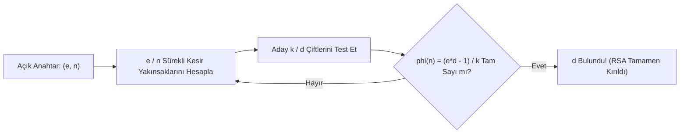

RSA algoritmasının matematiksel zarafeti, en küçük bir parametre seçim hatasında tüm güvenliğin kağıttan bir kule gibi yıkılmasına neden olur. Bu bölümde en meşhur RSA kriptanaliz tekniklerini inceleyeceğiz.

---

## 1. Teorik Sezgi & Matematik

### 1. Fermat Çarpanlara Ayırma Saldırısı (Yakın Asallar)

Eğer anahtar üretimi sırasında seçilen $p$ ve $q$ asalları birbirine sayısal olarak çok yakınsa ($|p - q|$ küçükse):
$$n = p \cdot q = \left(\frac{p+q}{2}\right)^2 - \left(\frac{p-q}{2}\right)^2 = a^2 - b^2$$

Saldırgan $a = \lceil\sqrt{n}\rceil$'den başlayarak $a^2 - n$ değerinin tam kare ($b^2$) olup olmadığını dener. Birkaç yüz adımda $a$ ve $b$ bulunarak $p = a + b$ ve $q = a - b$ çarpanları anında elde edilir.

### 2. Wiener Saldırısı (Küçük Gizli Üs $d$)

Deşifreleme hızını artırmak amacıyla küçük bir gizli üs seçilirse ($d < \frac{1}{3} n^{1/4}$):
Michael J. Wiener, 1990 yılında **Sürekli Kesirler (Continued Fractions)** teoremini kullanarak açık anahtardan ($(e, n)$) gizli üs $d$'nin polinom zamanda hesaplanabileceğini kanıtlamıştır.

$$e \cdot d - k \cdot \phi(n) = 1 \implies \left| \frac{e}{n} - \frac{k}{d} \right| < \frac{1}{2 d^2}$$

Bu eşitsizlik gereği $k / d$, $e / n$'in sürekli kesir açılımındaki yakınsaklarından (*convergents*) biridir.



### 3. Ortak Modül Saldırısı (Common Modulus)

Aynı kurum içindeki iki kullanıcıya aynı $n$ modülü ancak farklı aralarında asal açık üsler ($e_1, e_2$) verilirse ($\gcd(e_1, e_2) = 1$); aynı $m$ mesajı her ikisine de şifrelendiğinde ($c_1 = m^{e_1} \bmod n$, $c_2 = m^{e_2} \bmod n$):
Bézout Özdeşliği gereği $e_1 r + e_2 s = 1$ katsayıları bulunur ve mesaj anahtarsız deşifre edilir:

$$c_1^r \cdot c_2^s \equiv (m^{e_1})^r \cdot (m^{e_2})^s \equiv m^{e_1 r + e_2 s} \equiv m^1 \pmod{n}$$

---

## 2. Gerçek Hayat Mimarisi: ROCA Zafiyeti (CVE-2017-15361)

2017 yılında Infineon güvenlik yongalarında (TPM, Akıllı Kartlar, Estonya e-kimlik kartları) donanım asallığı testini hızlandırmak için asalların belirli bir matematiksel kalıpla ($p = k \cdot M + (65537^a \bmod M)$) üretildiği ortaya çıktı. 
Bu kusur sayesinde 2048-bitlik RSA anahtarları, kuantum bilgisayara ihtiyaç duyulmadan sıradan AWS sunucularında birkaç yüz dolarlık hesaplama maliyetiyle çarpanlarına ayrıldı ve milyonlarca vatandaşlık kimlik kartı iptal edildi.

---

## 3. Uygulamalı Kod Örneği: Python ile Fermat Çarpanlara Ayırma Exploit'i

```python
import math

def is_square(n: int) -> bool:
    if n < 0:
        return False
    s = math.isqrt(n)
    return s * s == n

def fermat_factorization(n: int):
    """Birbirine yakın p ve q asallarını saniyeler içinde bulan Fermat algoritması."""
    a = math.isqrt(n)
    if a * a < n:
        a += 1

    steps = 0
    while True:
        steps += 1
        b2 = a * a - n
        if is_square(b2):
            b = math.isqrt(b2)
            p = a + b
            q = a - b
            return p, q, steps
        a += 1

# Test: Birbirine çok yakın üretilmiş iki adet 128-bit asal
p_secret = 170141183460469231731687303715884105757
q_secret = 170141183460469231731687303715884105823
n_vulnerable = p_secret * q_secret

print(f"[*] Hedef Modül n (256-bit): {n_vulnerable}")
p_found, q_found, iterations = fermat_factorization(n_vulnerable)

print(f"[✓] Çarpanlarına Ayrıldı! ({iterations} adımda)")
print(f"    p: {p_found}")
print(f"    q: {q_found}")
assert p_found * q_found == n_vulnerable
```

---

## 4. Güvenlik & Kriptanaliz Notu

> [!IMPORTANT]
> **Güvenli RSA Anahtarı Kriterleri**
> 1. Modül boyutu en az **2048 bit** (tercihen **3072 veya 4096 bit**) olmalıdır.
> 2. $p$ ve $q$ bağımsız CSPRNG ile üretilmeli, $|p - q| > 2^{n\_bits / 2 - 100}$ olmalıdır (Fermat saldırısını önlemek için).
> 3. Açık üs $e = 65537$ seçilmeli ($e = 3$ küçük açık üs zaaflarına açıktır).
> 4. Gizli üs $d$, Wiener sınırının çok üzerinde olmalıdır ($d > n^{0.5}$).

