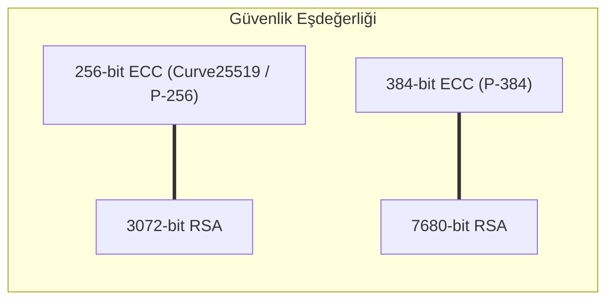

RSA'nın 2048 ve 4096 bitlik devasa anahtar boyutları; mobil cihazlarda, akıllı kartlarda ve IoT sistemlerinde bellek ve bant genişliği darboğazı yaratır. **Eliptik Eğri Kriptografisi (ECC)**, çok daha küçük anahtar boyutlarıyla (256 bit) RSA'dan daha yüksek güvenlik sağlayarak modern kriptografinin zirvesine yerleşmiştir.

---

## 1. Teorik Sezgi & Matematik

### Eliptik Eğri Denklemi (Weierstrass Formu)

Kriptografide eliptik eğriler, büyük bir $p$ asal modülü üzerindeki sonlu alanda ($\mathbb{F}_p$) tanımlanır:

$$y^2 \equiv x^3 + a x + b \pmod{p}$$

Burada eğrinin tekil (*singular*) olmaması (düğüm veya sivri uç içermemesi) için diskriminant şartı sağlanmalıdır:

$$4a^3 + 27b^2 \not\equiv 0 \pmod{p}$$

### Nokta Toplama ve Skaler Çarpım

Eğri üzerindeki noktalar sonsuzdaki nokta ($\mathcal{O}$ - birim eleman) ile birlikte bir değişmeli grup (*Abelian group*) oluşturur:
1. **Nokta Toplama ($P + Q$):** $P$ ve $Q$ noktalarından geçen doğru eğriyi üçüncü bir $R'$ noktasında keser. Bu noktanın $x$ eksenine göre yansıması toplamı verir: $R = P + Q$.
2. **Skaler Çarpım ($Q = k \cdot P$):** Bir $P$ noktasını kendisiyle $k$ kez toplama işlemidir (*Double-and-Add* ile $O(\log k)$ zamanda hesaplanır).

**ECDLP (Elliptic Curve Discrete Logarithm Problem):**
Verilen $P$ (taban noktası) ve $Q = k \cdot P$ değerlerinden gizli $k$ skaler çarpanını bulmak, bilinen hiçbir alt-üstel algoritma (sub-exponential) bulunmadığı için klasik DLP'den çok daha zordur.



---

## 2. Gerçek Hayat Mimarisi: NIST Eğrileri vs. Curve25519

Yıllarca standart kabul edilen NIST eğrileri (örneğin `secp256r1 / P-256`), NSA tarafından belirlenen açıklanamayan rastgele tohum (*seed*) sabitleri içermesi nedeniyle kriptografi topluluğunda arka kapı şüpheleri uyandırmıştır.

Daniel J. Bernstein (DJB) tarafından tasarlanan **Curve25519 (X25519)** ve **Ed25519**, bu şüpheleri ve uygulama tuzaklarını kökten çözmüştür:
* **Montgomery Formu ($y^2 = x^3 + 486662x^2 + x$):** $y$ koordinatına ihtiyaç duymadan sadece $x$ koordinatıyla ve **Montgomery Ladder** mimarisiyle çalışır.
* **Sabit Zamanlı Çalışma (Constant-Time):** İşlemci önbelleğini veya yürütme süresini izleyen yan kanal saldırılarına (*side-channel attacks*) karşı donanım seviyesinde doğal dirençlidir.
* **Geçersiz Nokta Saldırılarına Bağışıklık:** Gelen her 32 bayt geçerli bir $x$ koordinatıdır; eğri dışı nokta doğrulaması (*point validation*) gerektirmez.

---

## 3. Uygulamalı Kod Örneği: Python ile Weierstrass Eğrisi Üzerinde Nokta Aritmetiği

```python
class EllipticCurve:
    def __init__(self, a: int, b: int, p: int):
        self.a = a
        self.b = b
        self.p = p

    def is_on_curve(self, point) -> bool:
        if point is None:
            return True
        x, y = point
        return (y * y - (x**3 + self.a * x + self.b)) % self.p == 0

    def add(self, p1, p2):
        if p1 is None: return p2
        if p2 is None: return p1

        x1, y1 = p1
        x2, y2 = p2

        if x1 == x2 and y1 != y2:
            return None  # Sonsuzdaki nokta O

        if p1 == p2:
            # Nokta İkileme (Point Doubling): m = (3*x1^2 + a) / (2*y1) mod p
            num = (3 * x1**2 + self.a) % self.p
            den = (2 * y1) % self.p
        else:
            # Farklı İki Noktayı Toplama: m = (y2 - y1) / (x2 - x1) mod p
            num = (y2 - y1) % self.p
            den = (x2 - x1) % self.p

        inv_den = pow(den, self.p - 2, self.p) # Modüler Ters (Fermat)
        m = (num * inv_den) % self.p

        x3 = (m**2 - x1 - x2) % self.p
        y3 = (m * (x1 - x3) - y1) % self.p
        return (x3, y3)

    def scalar_mult(self, k: int, point):
        """Double-and-Add algoritması ile k * P hesaplama."""
        res = None
        current = point
        while k > 0:
            if k & 1:
                res = self.add(res, current)
            current = self.add(current, current)
            k >>= 1
        return res

# Test: y^2 = x^3 + 2x + 3 mod 97 eğrisi
curve = EllipticCurve(a=2, b=3, p=97)
base_point = (3, 6)
assert curve.is_on_curve(base_point)

# 2 * P ve 5 * P skaler çarpımı
p2 = curve.add(base_point, base_point)
p5 = curve.scalar_mult(5, base_point)

print(f"[+] Taban Noktası P : {base_point}")
print(f"[+] 2 * P           : {p2}")
print(f"[+] 5 * P           : {p5}")
assert curve.is_on_curve(p5)
```

---

## 4. Güvenlik & Kriptanaliz Notu

> [!CAUTION]
> **Geçersiz Eğri Saldırısı (Invalid Curve Attack)**
> Geleneksel Weierstrass eğrilerinde (örneğin NIST P-256), eğer yazılım karşı taraftan gelen açık anahtar koordinatlarının ($(x, y)$) gerçekten eğri üzerinde olup olmadığını doğrulamazsa ($y^2 \equiv x^3 + ax + b \pmod p$); saldırgan çok daha küçük alt gruplara sahip zayıf bir eğri üzerindeki noktayı göndererek kurbanın gizli anahtarını ($k$) adım adım sızdırabilir. 
> **Curve25519 (X25519)** mimarisi bu saldırıyı cebirsel yapısı gereği tamamen imkansız kılar.
