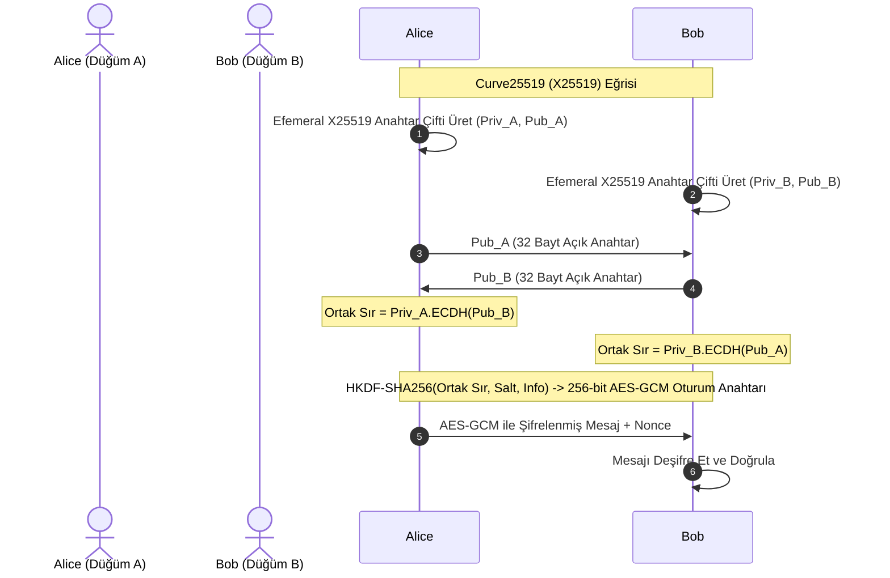

Bu laboratuvarda; Go dilinin modern standart kriptografi paketi olan `crypto/ecdh` kütüphanesini kullanarak, **Curve25519 (X25519)** üzerinde çalışan, **Mükemmel İleri Gizlilik (PFS)** destekli ve **HKDF** ile oturum anahtarı türeten uçtan uca güvenli bir Peer-to-Peer anahtar takas mekanizması geliştireceğiz.

---

## 1. Protokol Mimarisi



---

## 2. Tam Laboratuvar Kodu (Go)

Aşağıdaki Go kodu Go 1.20 ve üzeri sürümlerde harici üçüncü parti bağımlılık olmadan standart kütüphaneyle çalışır.

```go
package main

import (
	"crypto/aes"
	"crypto/cipher"
	"crypto/ecdh"
	"crypto/rand"
	"crypto/sha256"
	"fmt"
	"io"
	"golang.org/x/crypto/hkdf" // Standart RFC 5869 HKDF mantığı
)

// SimpleHKDF standart kütüphaneyle ham HKDF-Extract ve Expand işlemini simüle eder
func deriveKey(secret []byte, salt []byte, info []byte) []byte {
	kdf := hkdf.New(sha256.New, secret, salt, info)
	key := make([]byte, 32) // 256-bit AES anahtarı
	if _, err := io.ReadFull(kdf, key); err != nil {
		panic(err)
	}
	return key
}

func main() {
	fmt.Println("[*] CURVE25519 P2P ANAHTAR TAKASI BAŞLATILIYOR...")
	curve := ecdh.X25519()

	// 1. Adım: Alice ve Bob efemeral Curve25519 anahtar çiftlerini üretir
	alicePriv, err := curve.GenerateKey(rand.Reader)
	if err != nil {
		panic(err)
	}
	alicePub := alicePriv.PublicKey()

	bobPriv, err := curve.GenerateKey(rand.Reader)
	if err != nil {
		panic(err)
	}
	bobPub := bobPriv.PublicKey()

	fmt.Printf("[+] Alice Açık Anahtarı (32 Bayt): %x\n", alicePub.Bytes())
	fmt.Printf("[+] Bob Açık Anahtarı   (32 Bayt): %x\n", bobPub.Bytes())

	// 2. Adım: Taraflar karşı tarafın açık anahtarıyla ortak sırrı (ECDH) hesaplar
	aliceSharedSecret, err := alicePriv.ECDH(bobPub)
	if err != nil {
		panic(err)
	}

	bobSharedSecret, err := bobPriv.ECDH(alicePub)
	if err != nil {
		panic(err)
	}

	// 3. Adım: Ortak sırrın eşleştiğini doğrula
	fmt.Printf("[+] Ortak Sır (Alice): %x\n", aliceSharedSecret)
	fmt.Printf("[+] Ortak Sır (Bob)  : %x\n", bobSharedSecret)

	// 4. Adım: HKDF ile Ortak Sırdan 256-bit Simetrik AES-GCM Oturum Anahtarı Türet
	salt := []byte("p2p-secure-session-salt")
	info := []byte("aes-256-gcm-encryption-key")
	sessionKeyAlice := deriveKey(aliceSharedSecret, salt, info)
	sessionKeyBob := deriveKey(bobSharedSecret, salt, info)

	// 5. Adım: Alice mesajı şifreler, Bob deşifre eder
	block, _ := aes.NewCipher(sessionKeyAlice)
	gcm, _ := cipher.NewGCM(block)
	nonce := make([]byte, gcm.NonceSize())
	io.ReadFull(rand.Reader, nonce)

	message := []byte("Merhaba Bob! Curve25519 ile iletisimimiz tamamen guvende.")
	encryptedMessage := gcm.Seal(nil, nonce, message, nil)

	fmt.Printf("\n[>] Alice Gönderdi (Şifreli): %x\n", encryptedMessage)

	// Bob'un deşifre etmesi
	blockBob, _ := aes.NewCipher(sessionKeyBob)
	gcmBob, _ := cipher.NewGCM(blockBob)
	decrypted, err := gcmBob.Open(nil, nonce, encryptedMessage, nil)
	if err != nil {
		panic("Deşifreleme hatası!")
	}

	fmt.Printf("[<] Bob Aldı ve Çözdü      : %s\n", string(decrypted))
}
```

---

## 3. Güvenlik & Kriptanaliz Notu

:::caution[Ortak Sırrı Asla Doğrudan Simetrik Anahtar Olarak Kullanmayın]
Diffie-Hellman veya ECDH ile elde edilen ham ortak sır ($g^{ab}$ veya $k \cdot P$), kriptografik özetler gibi bit düzeyinde üniform (eşit) rastgele bir dağılıma sahip değildir; cebirsel bir grup yapısının kısıtlamalarını taşır. 
Bu ham değeri doğrudan AES anahtarı olarak kullanmak sisteme zafiyet sokar. Doğru pratik, ham sırrı daima **HKDF (RFC 5869)** gibi bir Kriptografik Anahtar Türetme Fonksiyonundan geçirerek homojen ve bağımsız oturum anahtarları üretmektir.
:::

