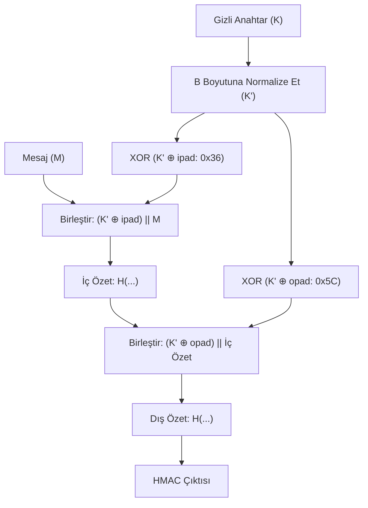

Bir özet fonksiyonu tek başına mesajın kaynağını doğrulayamaz; çünkü ağdaki herhangi bir saldırgan mesajı değiştirip yeni bir özet hesaplayabilir. Mesajın hem bütünlüğünü hem de yetkili bir taraftan geldiğini doğrulamak için **Mesaj Doğrulama Kodları (MAC)** kullanılır.

---

## 1. Teorik Sezgi & Matematik

### Neden $H(K \parallel M)$ Kullanılamaz? (Boyut Uzatma Saldırısı)

Geliştiricilerin düştüğü en yaygın tuzak, gizli bir anahtarı ($K$) mesajın önüne ekleyip özetlemektir: $MAC = SHA256(K \parallel M)$.
* Merkle-Damgård yapısında son blok işlendikten sonraki ara durum doğrudan hash çıktısıdır ($h$).
* Saldırgan $K$'yı hiç bilmese bile, $h$'yi başlangıç durumu (IV) olarak kullanarak mesajın sonuna yeni veriler ekleyebilir ($M \parallel \text{padding} \parallel \text{sahte\_veri}$) ve sunucunun kabul edeceği geçerli bir MAC üretebilir!

### HMAC Mimarisi (RFC 2104)

Mihir Bellare ve ekibi tarafından tasarlanan HMAC, bu yapısal zafiyeti **iç içe iki katmanlı özetleme** ile kökten çözer:

$$HMAC(K, M) = H\Big( (K' \oplus opad) \parallel H((K' \oplus ipad) \parallel M) \Big)$$

* $B$: Özet fonksiyonunun blok boyutu (SHA-256 için 64 bayt).
* $K'$: Anahtar $B$ boyutuna normalize edilir (uzunsa özetlenir, kısaysa sıfırlarla doldurulur).
* $ipad$ (inner pad): $0x36$ baytının $B$ kez tekrarlanması.
* $opad$ (outer pad): $0x5C$ baytının $B$ kez tekrarlanması.

İç özetin sonucu tekrar bir anahtar dönüşümüyle dış özetten geçirildiği için boyut uzatma saldırısı matematiksel olarak imkansız hale gelir.



---

## 2. Gerçek Hayat Mimarisi: Zamanlama Yan Kanal Saldırıları (Timing Attacks)

Web uygulamalarında ve API sunucularında gelen bir HMAC imzasını doğrulamak için standart dize karşılaştırması kullanılırsa:

```python
# ÖLÜMCÜL GÜVENLİK AÇIĞI:
if user_hmac == expected_hmac:
    return "Giriş Başarılı"
```

Klasik dize karşılaştırma fonksiyonları (`memcmp` veya `==`), **ilk uyuşmayan baytta döngüyü hemen sonlandırır (erken çıkış)**.
* Eğer saldırganın gönderdiği imzanın 0. baytı doğruysa, sunucu döngüde bir sonraki bayta geçeceği için yanıt süresi birkaç mikrosaniye daha uzun sürer.
* Ağ gecikmesini istatistiksel ortalamalarla filtreleyen bir saldırgan, $256 \times 32$ istekte doğru HMAC etiketini bayt bayt tamamen yeniden inşa eder.

---

## 3. Uygulamalı Kod Örneği: Python ve Go ile Sabit Zamanlı HMAC Doğrulaması

### Python: `hmac.compare_digest` Kullanımı

```python
import hmac
import hashlib

def secure_verify_token(secret_key: bytes, message: bytes, received_mac: bytes) -> bool:
    """HMAC-SHA256 üretir ve sabit zamanlı (constant-time) doğrular."""
    expected_mac = hmac.new(secret_key, message, hashlib.sha256).digest()
    
    # hmac.compare_digest sabit zamanda tüm baytları karşılaştırır (Zamanlama sızıntısı yok!)
    return hmac.compare_digest(expected_mac, received_mac)

# Test
key = b"super-secret-api-key-2026"
msg = b"action=transfer_funds&amount=10000&to=account_42"

valid_mac = hmac.new(key, msg, hashlib.sha256).digest()
fake_mac = bytes([0] * len(valid_mac))

print(f"[+] Doğru İmza Testi : {secure_verify_token(key, msg, valid_mac)}")
print(f"[-] Sahte İmza Testi : {secure_verify_token(key, msg, fake_mac)}")
```

### Go: `crypto/subtle.ConstantTimeCompare`

```go
package main

import (
	"crypto/hmac"
	"crypto/sha256"
	"crypto/subtle"
	"fmt"
)

func CheckMAC(message, messageMAC, key []byte) bool {
	mac := hmac.New(sha256.New, key)
	mac.Write(message)
	expectedMAC := mac.Sum(nil)
	
	// subtle.ConstantTimeCompare 1 veya 0 döndürür, erken çıkış yapmaz!
	return subtle.ConstantTimeCompare(messageMAC, expectedMAC) == 1
}

func main() {
	key := []byte("secret-key")
	msg := []byte("API-Call: Admin")

	mac := hmac.New(sha256.New, key)
	mac.Write(msg)
	expected := mac.Sum(nil)

	isOK := CheckMAC(msg, expected, key)
	fmt.Printf("[+] Go Sabit Zamanlı HMAC Doğrulama: %v\n", isOK)
}
```

---

## 4. Güvenlik & Kriptanaliz Notu

> [!CAUTION]
> **API Güvenliği Kuralı: Doğrulama Daima Sabit Zamanlı Olmalıdır**
> Sadece HMAC değil; parola özetleri, API tokenları, CSRF tokenları ve oturum kimlikleri doğrulanırken **istisnasız her zaman** sabit zamanlı karşılaştırma fonksiyonları (`subtle.ConstantTimeCompare`, `hmac.compare_digest`) kullanılmalıdır.
