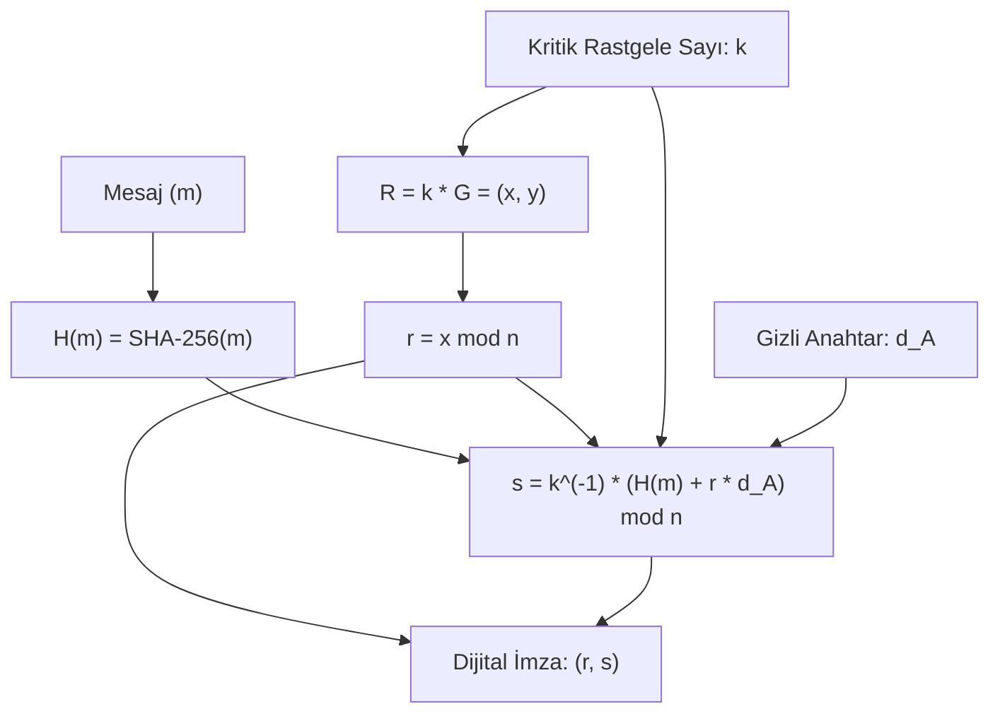

Dijital imzalar; el yazısı imzanın dijital dünyadaki karşılığıdır ancak ondan çok daha güçlüdür: Belgenin içeriğine kriptografik olarak kilitlenir, taklit edilemez ve imzalayan tarafın eylemini sonradan inkar etmesini (*Non-repudiation*) matematiksel olarak imkansız kılar.

---

## 1. Teorik Sezgi & Matematik

### ECDSA İmza Mekanizması

Eliptik eğriler üzerinde tanımlı ECDSA protokolünde:
* Taban noktası: $G$, eğri mertebesi: $n$
* Gizli anahtar: $d_A \in [1, n-1]$
* Açık anahtar: $Q_A = d_A \cdot G$

**İmza Üretimi ($r, s$):**
1. Gizli, kriptografik olarak rastgele tek kullanımlık bir sayı seçilir: $k \in [1, n-1]$.
2. Eğri üzerinde geçici bir nokta hesaplanır: $R = k \cdot G = (x_1, y_1)$.
3. İlk imza bileşeni: $r = x_1 \pmod{n}$ ($r \neq 0$ olmalıdır).
4. İkinci imza bileşeni:
   $$s \equiv k^{-1} (H(m) + r \cdot d_A) \pmod{n}$$
5. Mesajın imzası $(r, s)$ çiftidir.



---

## 2. Gerçek Hayat Mimarisi: Sony PlayStation 3 Felaketi (fail0verflow - 2010)

2010 yılında ünlü hacker grubu **fail0verflow**, Sony PlayStation 3'ün çekirdek seviyesindeki yazılım imzalama mekanizmasını tersine mühendislikle inceledi ve modern kriptografi tarihinin en büyük skandallarından birini ortaya çıkardı.

Sony mühendisleri, ECDSA formülündeki $k$ değerini her imzada rastgele seçmek yerine **sabit bir tamsayı olarak kodlamıştı** ($k = \text{sabit}$).

### $k$-Tekrarı Saldırısının Matematiği

Aynı $k$ değeriyle iki farklı mesaj ($m_1, m_2$) imzalandığında, her iki imzanın $r$ değeri özdeş olur ($r_1 = r_2 = r$):

$$s_1 \equiv k^{-1} (H(m_1) + r \cdot d_A) \pmod{n}$$
$$s_2 \equiv k^{-1} (H(m_2) + r \cdot d_A) \pmod{n}$$

İki denklemi birbirinden çıkarırsak:
$$s_1 - s_2 \equiv k^{-1} (H(m_1) - H(m_2)) \pmod{n}$$

Buradan tek kullanımlık sayı $k$ doğrudan çözülür:
$$k \equiv \frac{H(m_1) - H(m_2)}{s_1 - s_2} \pmod{n}$$

$k$ bulunduktan sonra Sony'nin tüm dünyadan gizlediği kök imza anahtarı ($d_A$) ilkokul cebiriyle saniyeler içinde hesaplanmıştır:
$$d_A \equiv \frac{s_1 \cdot k - H(m_1)}{r} \pmod{n}$$

Bu anahtar ifşa olduktan sonra PS3 konsolunun güvenlik mimarisi çökmüş; herhangi bir korsan yazılım Sony'nin resmi yazılımı gibi imzalanabilir hale gelmiştir.

---

## 3. Uygulamalı Kod Örneği: Python ile Sony PS3 $k$-Reuse Exploit'i

```python
# Basitleştirilmiş sonlu mertebe n üzerinde ECDSA k-reuse saldırısı
CURVE_N = 115792089237316195423570985008687907852837564279074904382605163141518161494337 # secp256k1 n

def mod_inv(a, m):
    return pow(a, m - 2, m)

def crack_ecdsa_private_key(h1: int, s1: int, h2: int, s2: int, r: int, n: int) -> int:
    """Aynı k ile imzalanmış iki mesajdan gizli anahtarı çözer."""
    # 1. k = (h1 - h2) / (s1 - s2) mod n
    numerator = (h1 - h2) % n
    denominator = (s1 - s2) % n
    k = (numerator * mod_inv(denominator, n)) % n

    # 2. d_A = (s1 * k - h1) / r mod n
    d_A = ((s1 * k - h1) * mod_inv(r, n)) % n
    return d_A

# Simülasyon
real_private_key = 0xDEADBEEFCAFE13371337B00B5
fixed_k = 0x4  # Sony usulü sabit k felaketi

# İki farklı mesaj özeti
hash_m1 = 0xAAAAAAAAAAAAAAAABBBBBBBBBBBBBBBB
hash_m2 = 0xCCCCCCCCCCCCCCCCDDDDDDDDDDDDDDDD

# İmzalar üretilir (r aynı kalır çünkü k sabit)
r_val = 0x123456789ABCDEF0123456789ABCDEF0
s1_val = (mod_inv(fixed_k, CURVE_N) * (hash_m1 + r_val * real_private_key)) % CURVE_N
s2_val = (mod_inv(fixed_k, CURVE_N) * (hash_m2 + r_val * real_private_key)) % CURVE_N

print(f"[*] Gerçek Gizli Anahtar : 0x{real_private_key:X}")
recovered_key = crack_ecdsa_private_key(hash_m1, s1_val, hash_m2, s2_val, r_val, CURVE_N)
print(f"[✓] Çözülen Gizli Anahtar: 0x{recovered_key:X}")
assert real_private_key == recovered_key
```

---

## 4. Güvenlik & Kriptanaliz Notu

> [!IMPORTANT]
> **Modern Çözüm: Deterministik İmzalar (RFC 6979 ve Ed25519)**
> ECDSA'daki $k$ rastgelelik hatası riskini tamamen ortadan kaldırmak için iki modern standart geliştirilmiştir:
> 1. **RFC 6979 (Deterministik ECDSA):** $k$ değeri bir CSPRNG'den rastgele çekilmez; gizli anahtarın ve mesaj özetinin HMAC'i alınarak deterministik olarak üretilir ($k = HMAC(d_A, H(m))$). Aynı mesaj her zaman aynı $k$'yı üretirken, farklı mesajlar kesinlikle farklı ve tahmin edilemez $k$ üretir.
> 2. **Ed25519 (Twisted Edwards):** Doğal olarak deterministiktir, rastgelelik üretimine ihtiyaç duymaz ve yan kanal saldırılarına karşı tam korumalıdır. Günümüzde SSH, Tor ve Signal'in varsayılan imza standardıdır.

