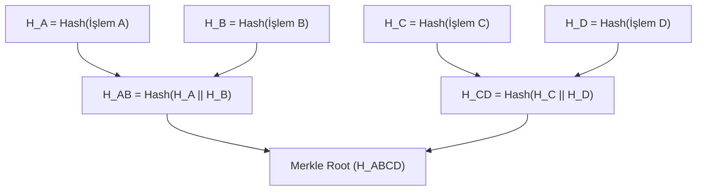

1979 yılında Ralph Merkle tarafından patentlenen **Merkle Ağaçları (*Merkle Trees*)**, devasa veri kümelerinin bütünlüğünü tek bir 32-baytlık kriptografik parmak izine indirgeyen ve büyük verilerde hızlı üyelik doğrulaması sağlayan en zarif veri yapılarından biridir.

---

## 1. Teorik Sezgi & Matematik

Merkle Ağacı, yaprak düğümlerin veri bloklarının özetlerini, üst düğümlerin ise çocuklarının özetlerinin birleşimini tuttuğu tam bir ikili özet ağacıdır (*Binary Hash Tree*).

### Yapısal Formül

1. **Yaprak Düğümler (Leaf Nodes):** 
   $$H_A = H(T_A), \quad H_B = H(T_B), \quad H_C = H(T_C), \quad H_D = H(T_D)$$
2. **Ara Düğümler (Parent Nodes):**
   $$H_{AB} = H(H_A \parallel H_B)$$
   $$H_{CD} = H(H_C \parallel H_D)$$
3. **Merkle Kökü (Merkle Root / Top Hash):**
   $$Root = H(H_{AB} \parallel H_{CD})$$

Tüm veri kümesindeki tek bir bit bile değişse, çığ etkisi gereği Merkle Kökü tamamen değişir.



### Merkle Denetim Kanıtı (Inclusion Proof)

$N$ adet işlem içeren bir veri setinde (örneğin 10.000 işlem içeren bir blokzincir bloğu veya 100 milyon sertifika içeren bir CT logu), belirli bir işlemin ($T_B$) o blokta var olduğunu kanıtlamak için tüm bloğu indirmeye gerek yoktur:
* Yalnızca hedef işlemin kardeş düğümleri verilir: $\{H_A, H_{CD}\}$.
* İstemci $H_{AB} = H(H_A \parallel H(T_B))$ ve ardından $H(H_{AB} \parallel H_{CD})$ hesaplar. Çıkan sonuç bilinen `Merkle Root` ile eşleşiyorsa üyelik **kesinleşir**.
* **Doğrulama Karmaşıklığı:** $O(N)$ yerine yalnızca **$O(\log_2 N)$** adımdır!

---

## 2. Gerçek Hayat Mimarisi

* **Blokzincir ve Hafif İstemciler (SPV Nodes):** Cep telefonlarındaki kripto cüzdanlar gigabaytlarca blok verisini indirmez; yalnızca blok başlığındaki 32-baytlık Merkle Kökünü tutar ve işlemlerini Merkle kanıtlarıyla milisaniyeler içinde teyit eder.
* **Git Versiyon Kontrolü:** Git reposundaki her commit, dosya ve dizin birer Merkle ağacı (DAG) düğümüdür (`blob`, `tree`, `commit`).
* **Sertifika Şeffaflığı (Certificate Transparency - CT):** Google Chrome ve tarayıcılar, sahte SSL sertifikalarını engellemek için tüm sertifikaların Append-Only bir Merkle ağacına kaydedildiğini denetler.

---

## 3. Uygulamalı Kod Örneği: Python ile Merkle Ağacı ve Üyelik Kanıtı

```python
import hashlib

def sha256(data: bytes) -> bytes:
    return hashlib.sha256(data).digest()

class MerkleTree:
    def __init__(self, transactions: list):
        self.leaves = [sha256(tx) for tx in transactions]
        self.tree = self.build_tree(self.leaves)
        self.root = self.tree[0][0] if self.tree else None

    def build_tree(self, leaves):
        levels = [leaves]
        current_level = leaves
        while len(current_level) > 1:
            next_level = []
            for i in range(0, len(current_level), 2):
                left = current_level[i]
                # Tek sayıda düğüm varsa sonuncusu kopyalanır
                right = current_level[i + 1] if i + 1 < len(current_level) else left
                parent = sha256(left + right)
                next_level.append(parent)
            levels.insert(0, next_level)
            current_level = next_level
        return levels

    def get_proof(self, tx_index: int):
        """tx_index için O(log N) Merkle kanıtı yolunu üretir."""
        proof = []
        index = tx_index
        # Aşağıdan yukarıya doğru seviyeleri tara
        for level in reversed(self.tree[1:]):
            sibling_index = index - 1 if index % 2 == 1 else index + 1
            if sibling_index < len(level):
                proof.append((level[sibling_index], "left" if index % 2 == 1 else "right"))
            else:
                proof.append((level[index], "right"))
            index //= 2
        return proof

def verify_proof(tx_data: bytes, proof: list, root: bytes) -> bool:
    """Yalnızca Merkle kanıtı ve kök hash ile işlemi doğrular."""
    current_hash = sha256(tx_data)
    for sibling_hash, direction in proof:
        if direction == "left":
            current_hash = sha256(sibling_hash + current_hash)
        else:
            current_hash = sha256(current_hash + sibling_hash)
    return current_hash == root

# Test
txs = [b"Tx1: Alice->Bob 5 BTC", b"Tx2: Bob->Charlie 2 BTC", b"Tx3: Dave->Eve 1 BTC", b"Tx4: Frank->Grace 9 BTC"]
tree = MerkleTree(txs)
print(f"[+] Merkle Root: {tree.root.hex()}")

# Tx2 için Kanıt Üret ve Doğrula
proof_tx2 = tree.get_proof(1)
is_valid = verify_proof(txs[1], proof_tx2, tree.root)
print(f"[✓] Tx2 İçin Merkle Kanıtı Doğrulandı mı? -> {is_valid}")
assert is_valid
```

---

## 4. Güvenlik & Kriptanaliz Notu

:::danger[İkinci Ön-Görüntü Saldırısı (Second Pre-image Attack in Merkle Trees)]
Eğer ağaçta yaprak düğümler ile ara düğümler birbirinden ayırt edilmezse; $H(H_A \parallel H_B)$ düğümü aynı zamanda bir yaprak gibi gösterilerek sahte veri enjekte edilebilir. 
Güvenli sistemlerde (örneğin RFC 6962 CT logları) yapraklar özetlenirken başına `0x00` baytı, ara düğümler özetlenirken ise `0x01` baytı eklenerek (*Domain Separation*) bu saldırı engellenir:
$$H_{leaf} = H(0\text{x}00 \parallel data), \quad H_{node} = H(0\text{x}01 \parallel left \parallel right)$$
:::

