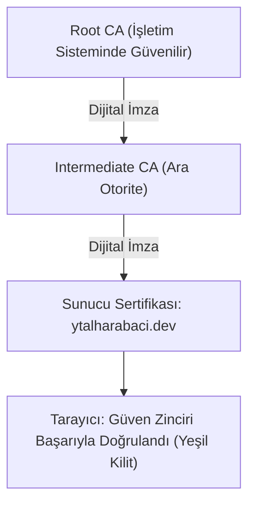

İnternet üzerinde bir sunucuya bağlandığınızda karşınızdaki sunucunun gerçekten hedef banka veya kurum olduğunu nasıl anlarsınız? Bu sorunun cevabı, küresel güven ekosistemini ayakta tutan **Açık Anahtar Altyapısı (*Public Key Infrastructure - PKI*)** ve **X.509** standartlarıdır.

---

## 1. Teorik Sezgi & Matematik

PKI, açık anahtarlar ile bu anahtarların sahibi olan tüzel kişilikler (domain adları, kurumlar) arasındaki bağı güvenilir bir üçüncü taraf (**Sertifika Otoritesi - CA**) aracılığıyla kriptografik olarak mühürler.

### Güven Zinciri (Chain of Trust)

Bir X.509 sertifikasının geçerliliği hiyerarşik bir imza zinciriyle doğrulanır:
1. **Kök Sertifika Otoritesi (Root CA):** İşletim sistemlerinin ve tarayıcıların güven deposunda (*Trust Store*) önceden yüklü gelen, kendi kendini imzalamış (*self-signed*) en üst seviye otoritedir. Çevrimdışı ve ultra-güvenli kasalarda saklanır.
2. **Ara Sertifika Otoritesi (Intermediate CA):** Kök CA'nın imzaladığı ve günlük sertifika basım işlemlerini yürüten ara kurumlardır.
3. **Uç Nokta / Yaprak Sertifika (End-Entity / Leaf):** Web sunucusunun (örneğin `ytalharabaci.dev`) kullandığı sertifikadır.

Doğrulama işlemi yapraktan başlar; her sertifikanın imzası bir üst otoritenin açık anahtarıyla doğrulanarak güven deposundaki bir Kök CA'ya ulaşılana kadar zincir takip edilir.



### Sertifika İptali: CRL vs. OCSP Stapling

Bir sunucunun gizli anahtarı çalınırsa sertifikanın son kullanma tarihinden önce iptal edilmesi gerekir:
* **CRL (Certificate Revocation List):** CA'nın yayınladığı yüz binlerce iptal edilmiş seri numarasını içeren devasa dosyalardır; yavaş ve verimsizdir.
* **OCSP (Online Certificate Status Protocol):** Tarayıcının her bağlantıda CA'ya *"Bu sertifika geçerli mi?"* diye sormasıdır. Gizlilik ihlali yaratır ve CA sunucusu çökerse web trafiği felç olur.
* **Modern Çözüm: OCSP Stapling (RFC 6066):** Web sunucusu, CA'dan aldığı taze ve dijital imzalı OCSP yanıtını doğrudan TLS el sıkışması sırasında tarayıcıya iletir. Tarayıcının CA'ya bağlanmasına gerek kalmaz (sıfır gecikme, tam gizlilik).

---

## 2. Gerçek Hayat Mimarisi: Certificate Transparency (CT)

2011 yılında sahte DigiNotar CA saldırısında saldırganlar Google, Yahoo ve Tor için sahte sertifikalar üretip binlerce kullanıcıyı dinlemiştir. 
Bu felaketin ardından **Certificate Transparency (CT - RFC 6962)** zorunlu kılınmıştır:
* Dünyada yayınlanan her SSL sertifikası, yalnızca eklenebilir (*append-only*) bir **Merkle Ağacı loguna** kaydedilmek zorundadır.
* Google Chrome, log kaydı kanıtı (**SCT - Signed Certificate Timestamp**) içermeyen hiçbir web sitesini açmaz.

---

## 3. Uygulamalı CLI Rehberi: OpenSSL ile Özel CA ve Sertifika Üretimi

Aşağıdaki komutlar yerel ağda tam bir PKI hiyerarşisi oluşturur:

```bash
# 1. Kök CA Gizli Anahtarı ve Öz-İmzalı Sertifikası (Root CA)
openssl ecparam -name prime256v1 -genkey -noout -out rootCA.key
openssl req -x509 -new -nodes -key rootCA.key -sha256 -days 3650 \
  -subj "/CN=Kurumsal Guvenlik Root CA/O=SiberLab/C=TR" -out rootCA.crt

# 2. Web Sunucusu İçin Anahtar ve Sertifika İmza Talebi (CSR)
openssl ecparam -name prime256v1 -genkey -noout -out server.key
openssl req -new -key server.key -subj "/CN=ytalharabaci.dev/O=Blog/C=TR" -out server.csr

# 3. Kök CA ile Sunucu Sertifikasını İmzalama (SAN Uzantısı Eklenerek)
openssl x509 -req -in server.csr -CA rootCA.crt -CAkey rootCA.key -CAcreateserial \
  -out server.crt -days 365 -sha256 \
  -extfile <(echo "subjectAltName=DNS:ytalharabaci.dev,DNS:*.ytalharabaci.dev")

# 4. Güven Zinciri Doğrulama
openssl verify -CAfile rootCA.crt server.crt
```

---

## 4. Güvenlik & Kriptanaliz Notu

> [!CAUTION]
> **Sertifika Sabitleme (Certificate Pinning) Tehlikesi**
> Geçmişte mobil uygulamalar MitM saldırılarını önlemek için sunucunun tam sertifikasını uygulama içine gömerdi (*Certificate Pinning*). Ancak sunucu sertifikası yenilendiğinde veya anahtar ifşa olduğunda güncellenemeyen mobil uygulamalar tamamen erişilemez hale gelmiştir. 
> Modern standart; sertifikanın kendisini değil, Kök/Ara CA açık anahtar özetini sabitlemek (**HPKP yerine CT log takibi ve CAA kayıtları**) kullanmaktır.

