2018 yılında IETF tarafından yayınlanan **TLS 1.3 (RFC 8446)**, internet güvenlik tarihinin en kapsamlı sadeleştirme ve güvenlik sıkılaştırma reformudur. Geçmiş 20 yılın tüm kriptografik kamburlarını tek bir hamlede atmıştır.

---

## 1. Teorik Sezgi & Matematik

### TLS 1.2 ile TLS 1.3 Arasındaki Radikal Farklar

| Özellik | TLS 1.2 | TLS 1.3 |
| :--- | :--- | :--- |
| **El Sıkışma Gecikmesi** | 2-RTT (2 Gidiş-Dönüş) | **1-RTT** (Opsiyonel 0-RTT Early Data) |
| **Anahtar Değişimi** | Statik RSA, Statik DH, DHE, ECDHE | **Yalnızca ECDHE** (Curve25519, P-256) |
| **Mükemmel İleri Gizlilik** | İsteğe bağlı (Çoğu zaman kapalıydı) | **Zorunlu (PFS)** |
| **Şifreleme Algoritmaları** | CBC, RC4, 3DES, AES-GCM | **Yalnızca AEAD** (GCM, CCM, Poly1305) |
| **Gizlilik / Metadata** | Sertifikalar açık metin olarak gider | **Sertifikalar ve uzantılar şifrelenir** |

```mermaid
sequenceDiagram
    autonumber
    actor Client as İstemci (Browser)
    actor Server as Web Sunucusu

    rect rgb(20, 30, 45)
        Note over Client,Server: 1-RTT Tam TLS 1.3 El Sıkışması
        Client->>Server: ClientHello + key_share (X25519 Açık Değeri)
        Server->>Client: ServerHello + key_share (X25519 Açık Değeri)
    end

    Note over Client,Server: Ortak Sır Hesaplandı -> Bu noktadan sonrası ŞİFRELİDİR!

    rect rgb(35, 25, 45)
        Server->>Client: {EncryptedExtensions}
        Server->>Client: {Certificate (Şifrelenmiş Sunucu Sertifikası)}
        Server->>Client: {CertificateVerify (İmza Doğrulama)}
        Server->>Client: {Finished}
        Client->>Server: {Finished}
    end

    Note over Client,Server: Güvenli Uygulama Trafiği (HTTP/2 - HTTP/3)
    Client->>Server: HTTP GET /dashboard (AEAD Şifreli)
```



### HKDF Anahtar Türetme Çizelgesi

TLS 1.3, tüm oturum ve el sıkışma anahtarlarını **HKDF (HMAC-based Extract-and-Expand KDF)** mantığıyla hiyerarşik olarak üretir:
1. **Early Secret:** PSK (Önceden paylaşılan anahtar) varsa 0-RTT için üretilir.
2. **Handshake Secret:** ECDH ortak sırrından türetilir; el sıkışmanın kalanını (sertifikaları) şifreler.
3. **Master Secret:** Nihai uygulama verilerini (HTTP trafiğini) şifreleyen `client_application_traffic_secret` ve `server_application_traffic_secret` anahtarlarını türetir.

---

## 2. Gerçek Hayat Mimarisi: 0-RTT (Early Data) ve Yeniden Oynatma (Replay) Saldırısı

TLS 1.3, daha önce bağlanılmış bir sunucuya sıfır gidiş-dönüş süresiyle (**0-RTT**) veri göndermeyi destekler. İstemci ilk `ClientHello` paketinin içine doğrudan HTTP GET isteğini gömer.

> **Güvenlik Riski (Replay Attack):**
> 0-RTT paketleri Mükemmel İleri Gizliliğe sahip değildir ve ağdaki bir saldırgan tarafından kaydedilip sunucuya defalarca **yeniden gönderilebilir**.
> * Eğer 0-RTT içinde `POST /banka/para-transferi` gibi durum değiştiren bir istek gönderilirse, saldırgan transferin defalarca tekrarlanmasına yol açabilir!
> * **Kural:** 0-RTT yalnızca kesinlikle yan etkisi olmayan (*idempotent*) `GET` isteklerinde kullanılmalıdır.

---

## 3. Uygulamalı Kod Örneği: Python ile TLS 1.3 Şifre Süitlerinin Zorlanması

Aşağıdaki betik; istemcinin yalnızca modern TLS 1.3 protokolü ve güvenli AEAD süitleriyle el sıkışmasını denetleyen bir soket istemcisidir.

```python
import socket
import ssl

hostname = "cloudflare.com"
context = ssl.create_default_context()

# TLS 1.2 ve önceki tüm eski sürümleri kesinlikle yasakla
context.minimum_version = ssl.TLSVersion.TLS1_3
context.maximum_version = ssl.TLSVersion.TLS1_3

with socket.create_connection((hostname, 443), timeout=5) as sock:
    with context.wrap_socket(sock, server_hostname=hostname) as tls_sock:
        cipher_info = tls_sock.cipher()
        tls_version = tls_sock.version()

        print(f"[+] Bağlantı Kuruldu: {hostname}")
        print(f"[+] TLS Sürümü      : {tls_version}")
        print(f"[+] Şifre Süiti     : {cipher_info[0]}")
        print(f"[+] Şifreleme Biti  : {cipher_info[2]} bit")
        assert tls_version == "TLSv1.3"
```

---

## 4. Güvenlik & Kriptanaliz Notu

> [!WARNING]
> **Downgrade (Sürüm Düşürme) Saldırılarına Karşı TLS 1.3 Koruması**
> Saldırganlar istemci ile sunucu arasına girip desteklenen sürümler listesini tahrif ederek tarafları güvensiz eski sürümlere (TLS 1.0 veya SSL 3.0) zorlamaya çalışırdı (*Downgrade Attack*). 
> TLS 1.3, sunucu rastgele sayısının (*ServerRandom*) son 8 baytına sabit bir sihirli değer gömerek (`444F574E47524401`) sürüm düşürme girişimlerini el sıkışma anında tespit eder ve bağlantıyı anında keser.

