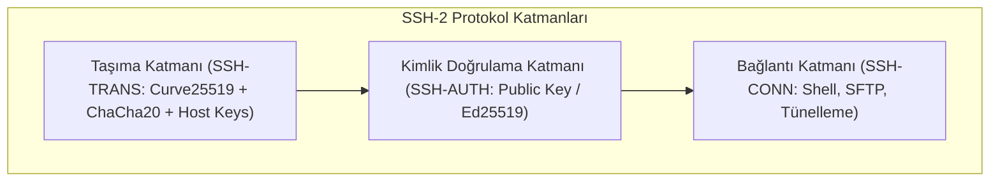

Uygulama katmanındaki web trafiğini TLS korurken; uzaktan sistem yönetimini **SSH (Secure Shell)**, şirketler arası ve şubeler arası ağ tünellemesini ise Ağ Katmanında (Layer 3) çalışan **IPsec** korur.

---

## 1. Teorik Sezgi & Matematik

### SSH-2 Protokol Katmanları (RFC 4251)

SSH protokolü 3 bağımsız katmandan meydana gelir:
1. **SSH-TRANS (Taşıma Katmanı):** Sunucu kimlik doğrulaması (*Host Key*), Diffie-Hellman (veya `curve25519-sha256`) ile şifreli kanal kurulumu ve bütünlük (HMAC / ChaCha20-Poly1305).
2. **SSH-AUTH (Kullanıcı Kimlik Doğrulama):** Parola veya asimetrik açık anahtar (`~/.ssh/authorized_keys`) ile kullanıcının sisteme kabulü.
3. **SSH-CONN (Bağlantı Katmanı):** Çoklanmış kanallar üzerinden terminal kabuğu (`pty`), dosya aktarımı (`sftp/scp`) ve TCP port tünelleme.



### IPsec Mimarisi: ESP vs. AH

IPsec, IP paketlerini doğrudan 3. katmanda korur. İki ana alt protokolden oluşur:

* **AH (Authentication Header - Protokol 51):** Verinin bütünlüğünü ve kaynağını doğrular ancak **şifreleme yapmaz** (paket içeriği okunabilir). IP başlığını da doğruladığı için NAT (Ağ Adresi Çevirisi) arkasında çalışamaz.
* **ESP (Encapsulating Security Payload - Protokol 50):** Hem güçlü simetrik şifreleme (AES-GCM) hem de bütünlük sağlar. Günümüzde kurumsal VPN'lerin fiili standardıdır.

**Çalışma Modları:**
* **Taşıma Modu (Transport Mode):** Orijinal IP başlığı korunur, yalnızca veri (*payload*) şifrelenir (uçtan uca sunucu iletişimi).
* **Tünel Modu (Tunnel Mode):** Tüm orijinal IP paketi şifrelenir ve yeni bir IP başlığıyla sarmalanır (Site-to-Site VPN ağları).

---

## 2. Gerçek Hayat Mimarisi: SSH Host Key ve TOFU Modeli

SSH, X.509 gibi merkezi bir CA hiyerarşisi yerine **TOFU (Trust On First Use - İlk Kullanımda Güven)** modelini benimser:
* Bir sunucuya ilk kez bağlandığınızda sunucunun açık anahtar parmak izi (*fingerprint*) istemcinin `~/.ssh/known_hosts` dosyasına kaydedilir.
* Eğer ikinci bağlantıda sunucu farklı bir anahtar sunarsa; istemci hemen kırmızı alarmla bağlantıyı keser:
  `WARNING: REMOTE HOST IDENTIFICATION HAS CHANGED! - MitM Saldırısı Olasılığı!`

---

## 3. Uygulamalı Kod Örneği: Python (`paramiko`) ile Ed25519 Tabanlı Güvenli SSH Bağlantısı

```python
import paramiko

def secure_ssh_connect(host: str, username: str, key_path: str):
    """Yalnızca modern Ed25519 anahtarı ve katı host key doğrulamasıyla SSH bağlantısı kurar."""
    client = paramiko.SSHClient()
    
    # Bilinmeyen host key'leri körü körüne kabul ETME (RejectPolicy)
    client.set_missing_host_key_policy(paramiko.RejectPolicy())
    client.load_system_host_keys()

    try:
        # Ed25519 özel anahtarı yükle
        pkey = paramiko.Ed25519Key.from_private_key_file(key_path)
        
        client.connect(
            hostname=host,
            port=22,
            username=username,
            pkey=pkey,
            look_for_keys=False,
            timeout=5
        )
        print(f"[✓] {host} sunucusuna Ed25519 ile güvenli bağlantı sağlandı.")
        
        stdin, stdout, stderr = client.exec_command("uname -a")
        print(f"[+] Çıktı: {stdout.read().decode().strip()}")

    except paramiko.BadHostKeyException:
        print("[!] KRİTİK GÜVENLİK ALARMI: Sunucu parmak izi uyuşmuyor! (MitM Şüphesi)")
    finally:
        client.close()
```

---

## 4. Güvenlik & Kriptanaliz Notu

> [!CAUTION]
> **SSH Agent Forwarding (`ssh -A`) Tehlikesi**
> Geliştiriciler uzak sunucular üzerinden başka sunuculara zıplamak (*jump host*) için sıklıkla `ssh -A` (Agent Forwarding) özelliğini açar. 
> Eğer ara sunucuda root yetkisine sahip kötü niyetli biri varsa, yerel makinenizdeki SSH-Agent UNIX soketine bağlanarak sizin gizli anahtarlarınızla dilediği sunucuya sizin adınıza oturum açabilir. 
> **Güvenli Çözüm:** `ssh -A` yerine modern **ProxyJump (`ssh -J`)** direktifi kullanılmalıdır (anahtar asla ara sunucuya temas etmez).
