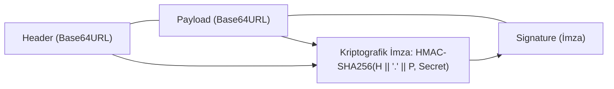

Modern web uygulamaları ve mikroservis mimarileri, durumsuz (*stateless*) kimlik doğrulama için neredeyse evrensel olarak **JSON Web Token (JWT - RFC 7519)** kullanır. Ancak JWT spesifikasyonundaki esneklikler, tarihin en yaygın kriptografik yetkilendirme açıklarına neden olmuştur.

---

## 1. Teorik Sezgi & Matematik

Bir JWT tokenı, nokta ile ayrılmış 3 adet `Base64URL` kodlanmış bölümden oluşur:
$$\text{Token} = \text{Header} \parallel .\parallel \text{Payload} \parallel .\parallel \text{Signature}$$

1. **Header (Başlık):** Algoritma türü (`alg`) ve token türü (`typ`): `{"alg": "RS256", "typ": "JWT"}`.
2. **Payload (Gövde):** Kullanıcı kimliği ve yetki iddiaları (*claims*): `{"sub": "1001", "role": "user"}`.
3. **Signature (İmza):** Başlık ve gövdenin gizli anahtarla imzalanmış hali:
   $$\text{Sig} = Sign_{K}(\text{Base64URL}(H) \parallel .\parallel \text{Base64URL}(P))$$



---

## 2. Kriptografik Zafiyetler ve Saldırı Vektörleri

### 1. `alg: "none"` Güvenlik Açığı

JWT spesifikasyonunda imzasız tokenlar için `"alg": "none"` opsiyonu tanımlanmıştır. Birçok popüler JWT kütüphanesinin ilk sürümleri, başlıkta `"alg": "none"` gördüğünde imza alanını hiç kontrol etmeden tokenı geçerli kabul etmiştir. 
* Saldırgan token gövdesindeki `"role": "user"` alanını `"role": "admin"` yapar, imza kısmını siler ve sunucuya göndererek sistemde root yetkisi kazanır.

### 2. Algoritma Karışıklığı / Key Confusion Saldırısı (RS256 $\rightarrow$ HS256)

Asimetrik imzalarda (RS256) iki anahtar vardır:
* **Gizli Anahtar (Private Key):** Sadece kimlik sunucusunda durur, imzayı atar.
* **Açık Anahtar (Public Key):** Herkese açıktır (`/jwks.json` veya `public.pem`), mikroservisler imzayı doğrular.

Eğer doğrulayıcı sunucu algoritmayı zorlamıyorsa:
1. Saldırgan token başlığını `"alg": "HS256"` (simetrik HMAC) olarak değiştirir.
2. Saldırgan sunucunun **herkese açık `public.pem` anahtar metnini simetrik gizli anahtar olarak kullanarak** bir HMAC-SHA256 imzası üretir!
3. Sunucu doğrulamaya çalıştığında: `jwt.verify(token, publicKey)` çağrılır. Kütüphane başlığa bakar (`HS256`), parametre olarak verilen `publicKey` dizesini simetrik bir parola sanır ve doğrulamayı başarıyla onaylar!

---

## 3. Uygulamalı Kod Örneği: Python ile Güvenli JWT Doğrulayıcı

```python
import hmac
import hashlib
import json
import base64

class SecureJWTValidator:
    def __init__(self, expected_secret: bytes, allowed_algorithm: str = "HS256"):
        self.secret = expected_secret
        self.allowed_alg = allowed_algorithm

    @staticmethod
    def _b64_decode(data: str) -> bytes:
        # Base64URL dolgu eksikliklerini tamamlar
        padding = '=' * (-len(data) % 4)
        return base64.urlsafe_b64decode(data + padding)

    def verify_and_decode(self, token: str) -> dict:
        parts = token.split(".")
        if len(parts) != 3:
            raise ValueError("Geçersiz JWT formatı!")

        header_b64, payload_b64, signature_b64 = parts

        # 1. Başlığı Ayrıştır ve Algoritmayı Katı Şekilde Doğrula
        header = json.loads(self._b64_decode(header_b64))
        token_alg = header.get("alg")

        # alg: none ve Key Confusion engeli
        if token_alg != self.allowed_alg or token_alg.lower() == "none":
            raise PermissionError(f"Güvenlik İhlali: İzin verilmeyen algoritma ({token_alg})!")

        # 2. İmzayı Sabit Zamanlı Doğrula
        signed_content = f"{header_b64}.{payload_b64}".encode('ascii')
        expected_sig = hmac.new(self.secret, signed_content, hashlib.sha256).digest()
        received_sig = self._b64_decode(signature_b64)

        if not hmac.compare_digest(expected_sig, received_sig):
            raise PermissionError("İmza Doğrulanamadı: Sahte Token!")

        # 3. Payload'ı Döndür
        return json.loads(self._b64_decode(payload_b64))


# Test
secret = b"guclu-kurumsal-jwt-anahtari-2026"
validator = SecureJWTValidator(secret, allowed_algorithm="HS256")

# Geçerli bir token oluşturulması
h_b64 = base64.urlsafe_b64encode(b'{"alg":"HS256","typ":"JWT"}').decode().rstrip("=")
p_b64 = base64.urlsafe_b64encode(b'{"sub":"42","role":"admin"}').decode().rstrip("=")
sig_b64 = base64.urlsafe_b64encode(hmac.new(secret, f"{h_b64}.{p_b64}".encode(), hashlib.sha256).digest()).decode().rstrip("=")
valid_token = f"{h_b64}.{p_b64}.{sig_b64}"

claims = validator.verify_and_decode(valid_token)
print(f"[✓] Başarıyla Doğrulanan Kullanıcı: ID={claims['sub']}, Rol={claims['role']}")

# Saldırı Testi: alg: none denemesi
fake_h_b64 = base64.urlsafe_b64encode(b'{"alg":"none","typ":"JWT"}').decode().rstrip("=")
malicious_token = f"{fake_h_b64}.{p_b64}."
try:
    validator.verify_and_decode(malicious_token)
except PermissionError as e:
    print(f"[!] Beklenen Savunma: {e}")
```

---

## 4. Güvenlik & Kriptanaliz Notu

:::danger[JWT Güvenli Doğrulama Kuralı]
Asla kütüphanenizin algoritmayı token başlığından (`header.alg`) otomatik seçmesine izin vermeyin. Doğrulama fonksiyonuna her zaman izin verilen algoritma listesini sabit parametre olarak geçin:
```go
// Go örneği:
jwt.Parse(tokenStr, keyFunc, jwt.WithValidMethods([]string{"RS256"}))
```
:::

