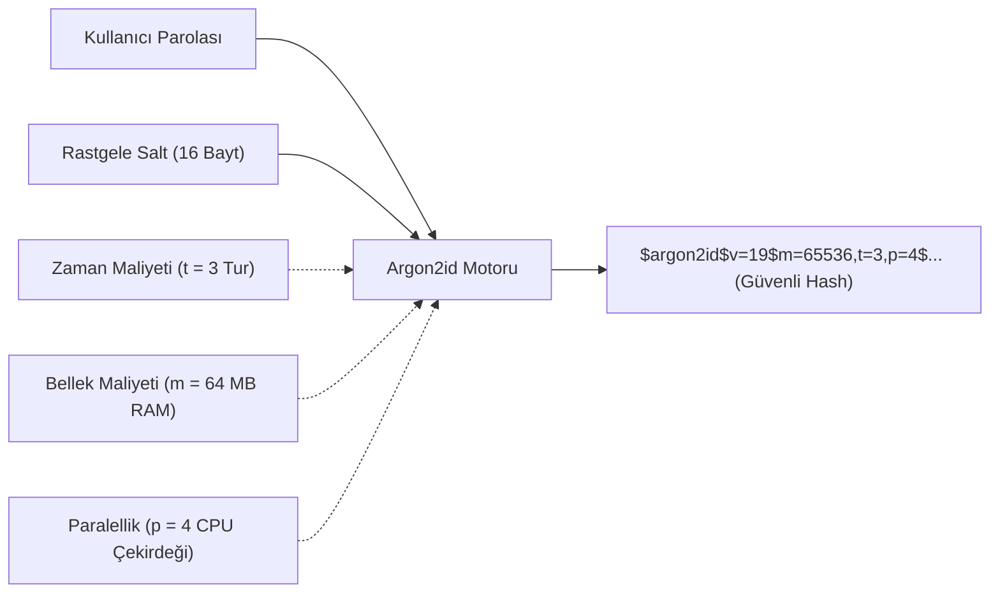

Kullanıcı parolalarını korumak; standart kriptografik özet fonksiyonlarından (SHA-256) tamamen farklı bir felsefe gerektirir. SHA-256 veriyi mümkün olan en kısa sürede işlemek üzere tasarlanmışken; bir parola hashleme algoritması kaba kuvvet saldırılarını imkansız kılmak için **kasıtlı olarak yavaş ve kaynak tüketici** olmak zorundadır.

---

## 1. Teorik Sezgi & Matematik

### Parola Saklama Evrimi

1. **Düz Metin (Plaintext):** Veritabanı sızıntısında tüm hesaplar anında ele geçer.
2. **Düz Hash ($H(P)$):** Saldırganlar **Gökkuşağı Tabloları (*Rainbow Tables*)** adını verdikleri milyarlarca önceden hesaplanmış özet tablosuyla $MD5$ veya $SHA1$ özetlerini anında açık metne çevirir.
3. **Tuzlanmış Hash ($H(P \parallel \text{Salt})$):** Her kullanıcı için benzersiz bir rastgele dize (*Salt*) üretilir. Gökkuşağı tablolarını tamamen işlevsiz kılar; ancak modern GPU'lar (RTX 4090) saniyede yüz milyarlarca tuzlu SHA-256 deneyebildiği için parola sözlük saldırılarına karşı yetersizdir.

### KDF Paradigmaları

| Algoritma | Tasarım Mantığı | Donanım Direnci (GPU/ASIC) |
| :--- | :--- | :--- |
| **PBKDF2** (RFC 2898) | HMAC'i binlerce kez döngüde çalıştırma ($c = 600.000$) | **Düşük:** Bellek gerektirmez, GPU ve ASIC çiplerinde paralel olarak çok hızlı kırılır. |
| **bcrypt** (Niels Provos) | Eksik anahtarlı Blowfish şifreleme ($2^C$ tur) | **Orta:** 4 KB iç bellek kullanır, GPU'lara karşı dirençlidir ancak modern FPGA'ler için küçük kalır. |
| **scrypt** (Colin Percival) | Bellek-Sert (*Memory-Hard*) tasarım | **Yüksek:** Kasıtlı olarak onlarca megabayt RAM tahsis eder. |
| **Argon2id** (RFC 9106) | PHC (2015) 1.si; Hibrit Bellek ve Zaman | **Maksimum:** Hem yan kanal saldırılarına hem de özel GPU/ASIC donanımlarına karşı tam koruma. |



---

## 2. Gerçek Hayat Mimarisi: Argon2id (RFC 9106)

Argon2 algoritması üç farklı modda sunulur:
* **Argon2d:** Bellek adresleme açık metin verisine bağlıdır. GPU madenciliğine karşı en yüksek direnci sağlar ancak önbellek zamanlama (*cache-timing*) saldırılarına açıktır.
* **Argon2i:** Bellek adresleme veriden bağımsızdır; zamanlama saldırılarına karşı tam korumalıdır ancak GPU'lara karşı biraz daha zayıftır.
* **Argon2id (Standart):** İlk turda Argon2i gibi davranarak yan kanal saldırılarını engeller; sonraki turlarda Argon2d gibi davranarak GPU/ASIC kaba kuvvet saldırılarını kilitler. OWASP'ın 1 numaralı önerisidir.

---

## 3. Uygulamalı Kod Örneği: Go ile Argon2id Parola Üretimi ve Doğrulaması

```go
package main

import (
	"crypto/rand"
	"crypto/subtle"
	"encoding/hex"
	"fmt"
	"golang.org/x/crypto/argon2"
)

// HashPassword OWASP standartlarında Argon2id özeti üretir
func HashPassword(password string) ([]byte, []byte, error) {
	salt := make([]byte, 16)
	if _, err := rand.Read(salt); err != nil {
		return nil, nil, err
	}

	// Parametreler: 3 Tur, 64 MB Bellek (64*1024 KB), 4 Paralel İş Parçacığı, 32 Bayt Anahtar
	hash := argon2.IDKey([]byte(password), salt, 3, 64*1024, 4, 32)
	return hash, salt, nil
}

// VerifyPassword Sabit zamanlı olarak parolayı doğrular
func VerifyPassword(password string, salt, expectedHash []byte) bool {
	hash := argon2.IDKey([]byte(password), salt, 3, 64*1024, 4, 32)
	return subtle.ConstantTimeCompare(hash, expectedHash) == 1
}

func main() {
	pwd := "Gizli_Ve_Guclu_Parola_2026!"

	hash, salt, err := HashPassword(pwd)
	if err != nil {
		panic(err)
	}

	fmt.Printf("[+] Salt (16 Bayt) : %s\n", hex.EncodeToString(salt))
	fmt.Printf("[+] Argon2id Özeti : %s\n", hex.EncodeToString(hash))

	// Doğrulama Testi
	isCorrect := VerifyPassword(pwd, salt, hash)
	isWrong := VerifyPassword("YanlisParola", salt, hash)

	fmt.Printf("[✓] Doğru Parola Doğrulandı mı? : %v\n", isCorrect)
	fmt.Printf("[!] Yanlış Parola Reddedildi mi? : %v\n", !isWrong)
}
```

---

## 4. Güvenlik & Kriptanaliz Notu

> [!IMPORTANT]
> **Donanım Maliyetini Savunmada Silah Olarak Kullanmak**
> Bir saldırganın özel ASIC çiplerinde saniyede 1 trilyon deneme yapabilmesinin nedeni, standart algoritmaların çip üzerinde neredeyse sıfır silikon alanı (birkaç transistör) kaplamasıdır. 
> **Argon2id**, tek bir parola doğrulaması için saldırganın çipine **64 Megabayt RAM** tahsis etme zorunluluğu getirir. Bir ASIC veya GPU üzerine terabaytlarca hızlı bellek koymak fiziksel ve mali olarak imkansız hale geldiğinden, saldırganın kaba kuvvet operasyonu ekonomik olarak iflas eder.
