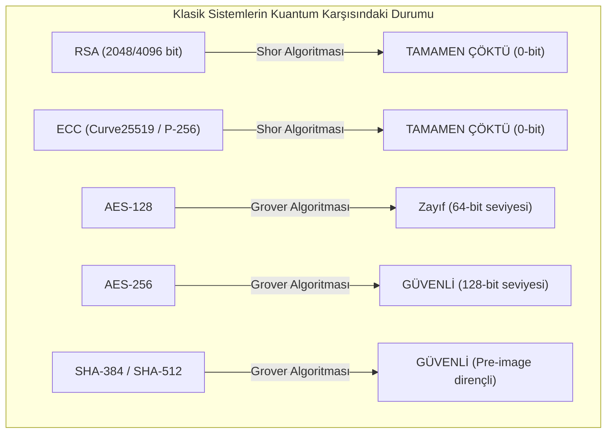

Büyük ölçekli evrensel bir kuantum bilgisayar inşa edildiğinde, bugün internet bankacılığından askeri haberleşmeye kadar dünyayı koruyan tüm açık anahtarlı şifreleme sistemleri (RSA, ECC, Diffie-Hellman) **saatler içinde tamamen çökecektir**. Bu varoluşsal tehdide karşı geliştirilen yeni nesil savunma hattı **Kuantum Sonrası Kriptografi (*Post-Quantum Cryptography - PQC*)** olarak adlandırılır.

---

## 1. Teorik Sezgi & Matematik

### Kuantum Algoritmalarının Tehdit Boyutu

1. **Shor Algoritması (1994):** Kuantum süperpozisyon ve kuantum Fourier dönüşümü (QFT) kullanarak periyot bulma problemini polinom zamanda çözer:
   * $O(\log^3 n)$ sürede asal çarpanlara ayırma (RSA) ve ayrık logaritma (DLP/ECDLP).
   * **Sonuç:** RSA, DSA, ECDSA, ECDH kuantum bilgisayarlar karşısında **%0 güvenlik seviyesine düşer**.
2. **Grover Algoritması (1996):** Yapılandırılmamış arama uzayını kuantum hızlandırmasıyla kareköküne indirir ($O(2^n) \rightarrow O(2^{n/2})$):
   * **Sonuç:** Simetrik anahtarların efektif boyutu yarıya iner. AES-128, 64-bit seviyesine düşerken; **AES-256 kuantum karşısında 128-bit güvenlik sağlayarak sağlam kalır**.



### Kafes Tabanlı Kriptografi (Lattice-Based Cryptography)

PQC'nin en umut verici matematiği $n$-boyutlu Öklid uzayındaki kafes (*lattice*) geometri problemlerine dayanır:
* **SVP (Shortest Vector Problem):** $n$-boyutlu (örneğin $n=1024$) bir kafeste orijine en yakın sıfırdan farklı vektörü bulmak klasik ve kuantum bilgisayarlar için NP-zor kabul edilir.
* **LWE (Learning With Errors):** Bir lineer denklem sistemine küçük rastgele gürültüler (hatalar) eklendiğinde, gizli vektörü çözmeyi imkansız kılan problemdir:
  $$\mathbf{A} \cdot \mathbf{s} + \mathbf{e} \equiv \mathbf{b} \pmod{q}$$
  Burada $\mathbf{A}$ açık matris, $\mathbf{b}$ açık sonuç, $\mathbf{e}$ küçük rastgele hata vektörü ve $\mathbf{s}$ gizli anahtardır.

---

## 2. Gerçek Hayat Mimarisi: NIST PQC Standartları (2024)

NIST, 8 yıl süren küresel değerlendirmenin ardından Ağustos 2024'te resmi FIPS standartlarını yayınlamıştır:

1. **FIPS 203: ML-KEM (Module-Lattice KEM - CRYSTALS-Kyber):** Anahtar Kapsülleme Mekanizması (*Key Encapsulation Mechanism*). TLS ve VPN el sıkışmalarında oturum anahtarı paylaşımının yeni dünya standardıdır.
2. **FIPS 204: ML-DSA (Module-Lattice DSA - CRYSTALS-Dilithium):** Genel amaçlı kuantum sonrası dijital imza standardı.
3. **FIPS 205: SLH-DSA (SPHINCS+):** Durumsuz, tamamen hash fonksiyonlarına (SHA-2 / SHAKE) dayalı yedek imza standardı.

### Hibrit Anahtar Değişimi (Hybrid Key Exchange)

Kriptografi dünyası *"hemen yeni bir algoritmaya körü körüne geçmeme"* kuralına sadıktır. Bu nedenle Cloudflare, Google Chrome ve OpenSSH şu an **Hibrit Mod** kullanır:
$$\text{Oturum Anahtarı} = KDF(\text{ECDH(X25519)} \parallel \text{ML-KEM-768})$$
Sistemi kırmak için saldırganın **hem eliptik eğrileri hem de kuantum sonrası kafes matematiğini aynı anda kırması** gerekir.

---

## 3. Uygulamalı Kod Örneği: Python ile LWE (Learning With Errors) Mantığı

```python
import numpy as np
import random

# Çok küçük boyutlu LWE Sezgisi Modeli
DIM = 4      # Vektör boyutu
MOD = 97     # Sonlu alan modülü

# Gizli anahtar vektörü s
secret_s = np.array([5, 12, 23, 7])

def generate_lwe_sample():
    # Açık rastgele vektör a
    a = np.random.randint(0, MOD, size=DIM)
    # Küçük gürültü/hata e (-1, 0, 1)
    error = random.choice([-1, 0, 1])
    # b = (a . s + e) mod MOD
    b = (np.dot(a, secret_s) + error) % MOD
    return a, b

# 5 adet açık denklem üretilir:
print(f"[*] Gizli Vektör s: {secret_s}")
print(f"[*] Üretilen LWE Açık Denklem Çiftleri (a, b):")
for i in range(3):
    a_vec, b_val = generate_lwe_sample()
    print(f"    Denklem {i+1}: a={a_vec} -> b = {b_val} (mod {MOD})")

print("\n[!] Gürültü (e) olmasaydı Gaussian eliminasyonu ile s saniyede bulunurdu.")
print("[!] Gürültü eklendiğinde, boyut n=1024 olduğunda kuantum bilgisayarlar bile s'yi çözemez!")
```

---

## 4. Güvenlik & Kriptanaliz Notu

> [!CAUTION]
> **"Şimdi Kaydet, Sonra Çöz" (Harvest Now, Decrypt Later - HNDL)**
> İstihbarat servisleri ve tehdit aktörleri, bugünün şifreli diplomatik, askeri ve kurumsal ağ trafiğini devasa veri merkezlerinde sessizce arşivlemektedir. Kuantum bilgisayarlar operasyonel hale geldiğinde geriye dönük 10-20 yıllık tüm bu arşiv şifresiz okunacaktır.
> Bu nedenle **PQC'ye geçiş geleceğin değil, bugünün acil güvenlik gereksinimidir**.
