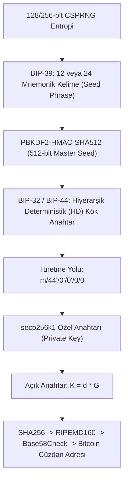

2008 yılında Satoshi Nakamoto takma adlı kişi veya grup tarafından yayınlanan Bitcoin makalesi (*“A Peer-to-Peer Electronic Cash System”*); yeni bir matematiksel keşif yapmamış, **kriptografinin önceki 30 yılda geliştirdiği tüm yapı taşlarını (SHA-256, ECDSA, Merkle Ağaçları, Zaman Damgaları)** tek bir dağıtık mutabakat mimarisinde ustalıkla birleştirmiştir.

---

## 1. Teorik Sezgi & Matematik

### 1. İş İspatı (Proof of Work - PoW)

Merkezi bir otorite (banka) olmadan ağın durumunda anlaşabilmek için madenciler belirli bir zorluk derecesini (*Target*) sağlayan bir `Nonce` sayısını aramak zorundadır:

$$\text{SHA-256}\Big(\text{SHA-256}(\text{Blok Başlığı} \parallel Nonce)\Big) < \text{Target}$$

* Hash fonksiyonunun tek yönlülüğü gereği, hedef değerden küçük bir özet bulmanın tek yolu **milyarlarca rastgele Nonce denemektir**.
* **Doğrulama:** Ağdaki diğer düğümler bulunan tek bir Nonce değerini mikrosaniyeler içinde ($O(1)$) doğrular (Hesaplaması zor, doğrulaması kolay).

### 2. Cüzdan Mimarisi ve Anahtar Hiyerarşisi

Kripto paralarda bir cüzdan *"bakiye"* tutmaz; yalnızca gizli anahtarları ve bu anahtarlardan deterministik olarak türetilen açık adresleri yönetir:



---

## 2. Gerçek Hayat Mimarisi: UTXO Modeli ve Çift Harcama

Klasik bankacılıkta hesaplar *"bakiye"* mantığıyla çalışırken; Bitcoin **UTXO (*Unspent Transaction Output - Harcanmamış İşlem Çıktısı*)** modelini kullanır:
* Her işlem önceki bir işlemin çıktısını tüketir ve yeni alıcının açık anahtar script'ine kilitlenen yeni çıktılar üretir.
* **Çift Harcama (Double-Spend) Koruması:** Bir madenci aynı UTXO'yu iki kez harcamaya çalışan bir işlemi bloğa ekleyemez; çünkü ağın çoğunluğunun üzerinde mutabık kaldığı en uzun zincir (*Longest Chain Rule*) ilk onaylanan işlemi geçerli sayar.

---

## 3. Uygulamalı Kod Örneği: Python ile Minimal Proof-of-Work Blokzincir Motoru

```python
import hashlib
import time
import json

class Block:
    def __init__(self, index: int, previous_hash: str, transactions: list, difficulty: int):
        self.index = index
        self.timestamp = time.time()
        self.previous_hash = previous_hash
        self.transactions = transactions
        self.difficulty = difficulty
        self.nonce = 0
        self.hash = self.mine_block()

    def calculate_hash(self) -> str:
        block_data = {
            "index": self.index,
            "timestamp": self.timestamp,
            "prev": self.previous_hash,
            "txs": self.transactions,
            "nonce": self.nonce
        }
        encoded = json.dumps(block_data, sort_keys=True).encode()
        # Bitcoin usulü Double-SHA-256
        return hashlib.sha256(hashlib.sha256(encoded).digest()).hexdigest()

    def mine_block(self) -> str:
        target_prefix = '0' * self.difficulty
        while True:
            current_hash = self.calculate_hash()
            if current_hash.startswith(target_prefix):
                return current_hash
            self.nonce += 1

# Test
print("[*] Blokzincir Başlatılıyor (Zorluk: 4 Adet Sıfır)...")
genesis_block = Block(0, "0"*64, ["Genesis: Siber Guvenlik Lab Odulu"], difficulty=4)
print(f"[✓] Genesis Blok Kazıldı!")
print(f"    Nonce : {genesis_block.nonce}")
print(f"    Hash  : {genesis_block.hash}")

block_1 = Block(1, genesis_block.hash, ["Alice->Bob 2.5 BTC", "Bob->Charlie 0.5 BTC"], difficulty=4)
print(f"\n[✓] 1. Blok Kazıldı!")
print(f"    Önceki Hash : {block_1.previous_hash}")
print(f"    Nonce       : {block_1.nonce}")
print(f"    Yeni Hash   : {block_1.hash}")
```

---

## 4. Güvenlik & Kriptanaliz Notu

> [!CAUTION]
> **51% Saldırısı ve Kuantum Tehdidi**
> * **%51 Saldırısı:** Ağdaki madencilik işlem gücünün yarısından fazlasını ele geçiren bir aktör, blokları gizlice geriden kazıp daha uzun bir zincir yayınlayarak kendi yaptığı ödemeleri geri alabilir (*Reorganize / Double-spend*).
> * **Kuantum Tehdidi:** Blokzincir adresleri ilk para transferi yapılana kadar sadece açık anahtarın özetini (SHA-256 + RIPEMD-160) saklar ve kuantum bilgisayarlara karşı güvendedir. Ancak adresten bir kez harcama yapıldığında açık anahtar ağa yayınlanır ve Shor algoritması ile gizli anahtarın kırılma riski doğar. Bu nedenle Bitcoin topluluğu **Kuantum Sonrası Taproot / Lamport imzalarına** geçiş hazırlığı yapmaktadır.
