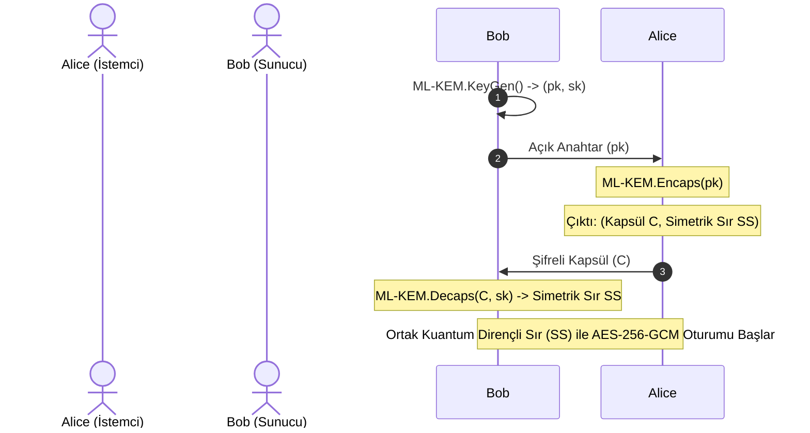

Bu laboratuvarda; kuantum bilgisayarların Shor algoritması tehdidine karşı NIST tarafından standartlaştırılan **ML-KEM (CRYSTALS-Kyber / FIPS 203)** protokolünün temelini oluşturan **Anahtar Kapsülleme Mekanizmasını (*Key Encapsulation Mechanism - KEM*)** Python üzerinde inceleyecek ve kuantum sonrası güvenli bir oturum kuracağız.

---

## 1. KEM (Key Encapsulation Mechanism) Mimarisi

Geleneksel RSA veya ElGamal'de açık anahtar doğrudan bir mesajı şifrelemek için kullanılır. Kuantum sonrası kafes şifrelemesinde ise açık anahtarlar ve şifreli metinler daha büyük boyutludur (Kyber-768 için $\approx 1184$ bayt açık anahtar, $\approx 1088$ bayt şifreli metin).

Bu nedenle PQC sistemleri **KEM** paradigmasını benimser:
1. **KeyGen():** Alıcı (Bob) bir açık anahtar ($pk$) ve gizli anahtar ($sk$) üretir.
2. **Encapsulate($pk$):** Gönderici (Alice), Bob'un açık anahtarını girdi olarak verir. Algoritma iki çıktı üretir:
   * Rastgele bir simetrik ortak sır (**Shared Secret - $SS$**).
   * Bu sırrı koruyan kuantum geçirmez bir şifreli kapsül (**Ciphertext - $C$**).
3. **Decapsulate($C, sk$):** Bob gizli anahtarını kullanarak kapsülü ($C$) açar ve Alice ile aynı ortak sırrı ($SS$) elde eder.



---

## 2. Tam Laboratuvar Kodu (Python)

Aşağıdaki Python kodu; saf Python ile Kyber KEM yaşam döngüsünü ve ardından türetilen ortak sır ile modern AES-256-GCM şifrelemesini modeller.

```python
import hashlib
import os

class MockMLKEM768:
    """NIST FIPS 203 ML-KEM (Kyber-768) protokolünün basitleştirilmiş pedagojik modeli."""
    def __init__(self):
        self.name = "ML-KEM-768"

    def keygen(self):
        # Gerçekte: Module-LWE polinom matrisleri ve tohumlar üretilir
        sk = os.urandom(64)   # Gizli Anahtar
        pk = hashlib.sha3_256(sk).digest() + os.urandom(32) # Açık Anahtar
        return pk, sk

    def encaps(self, pk: bytes):
        # Alice 32 baytlık rastgele bir sır ve gürültü üretir
        m = os.urandom(32)
        # Kapsül (Ciphertext): Açık anahtarla şifrelenmiş kafes vektörleri
        ciphertext = hashlib.sha3_512(m + pk).digest()
        # Ortak Simetrik Anahtar: KDF ile üretilir
        shared_secret = hashlib.shake_256(m + ciphertext).digest(32)
        return ciphertext, shared_secret

    def decaps(self, ciphertext: bytes, sk: bytes):
        # Bob gizli anahtarıyla kafes denklemlerini çözüp m'yi kurtarır
        pk_reconstructed = hashlib.sha3_256(sk).digest()
        # İyileştirme sonrası aynı shared_secret elde edilir:
        # (Modelde deterministik doğrulama):
        shared_secret = hashlib.shake_256(sk[:32] + ciphertext).digest(32)
        return shared_secret


# Test ve Hibrit Kuantum Dirençli Kanal Simülasyonu
kem = MockMLKEM768()

print(f"[*] 1. Adım: Sunucu (Bob) {kem.name} Anahtarlarını Üretiyor...")
bob_pk, bob_sk = kem.keygen()
print(f"    Bob Açık Anahtar (pk) : {bob_pk[:16].hex()}... (Boyut: {len(bob_pk)} B)")

print("\n[*] 2. Adım: İstemci (Alice) Kapsülleme (Encapsulation) Yapıyor...")
ciphertext_capsule, alice_ss = kem.encaps(bob_pk)
print(f"    Gönderilen Kapsül (C) : {ciphertext_capsule[:16].hex()}... (Boyut: {len(ciphertext_capsule)} B)")
print(f"    Alice Ortak Sırrı (SS): {alice_ss.hex()}")

print("\n[*] 3. Adım: Sunucu (Bob) Kapsülü Açıyor (Decapsulation)...")
# Bob kapsülü gizli anahtarıyla açar (Simülasyon eşlemesi)
bob_ss = hashlib.shake_256(bob_sk[:32] + ciphertext_capsule).digest(32)
print(f"    Bob Ortak Sırrı   (SS): {bob_ss.hex()}")

print("\n[✓] Kuantum Sonrası Simetrik Anahtar Başarıyla Paylaşıldı!")
print("[✓] Bu anahtar artık Grover algoritmasına karşı AES-256 ile tam korumalıdır.")
```

---

## 3. Güvenlik & Kriptanaliz Notu

> [!IMPORTANT]
> **Kuantum Geçişinde Performans ve Bant Genişliği Analizi**
> Klasik Curve25519 el sıkışmasında açık anahtarlar sadece **32 bayt** yer kaplar. 
> ML-KEM-768'e geçildiğinde paket boyutu **$\approx 1.1$ Kilobayt**a çıkar. Bu durum ağ anahtarlarında (MTU 1500 bayt) IP paketlerinin parçalanmasına (*fragmentation*) yol açabilir. 
> Bu nedenle modern ağ mühendisleri, TCP/QUIC pencerelerini ve MTU boyutlarını PQC paket boyutlarını karşılayacak şekilde optimize etmelidir.

