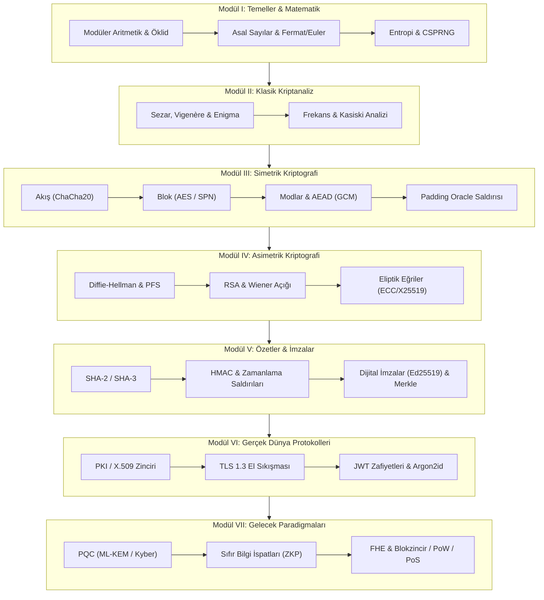

### Neden Bu Kitap?

Kriptoloji, sadece soyut teoremler ve karmaşık matematik ispatları yığını olmadığı gibi; yalnızca kütüphane çağırmaktan ibaret bir yazılım rutini de değildir. Bu kitap; **Kerckhoffs Prensibi'nden kuantum sonrası kafes matematiğine (PQC)**, **AES SubBytes dönüşümlerinden Padding Oracle istismarlarına**, **Curve25519 eliptik eğrilerinden sıfır bilgi ispatlarına (ZKP)** kadar tüm kritik süreçleri 4 adımlı standart bir pedagojiyle ele alır:

1. **Teorik Sezgi & Matematik:** Konunun ortaya çıkış nedeni, arkasındaki sadeleştirilmiş sayı teorisi ve formüller.
2. **Gerçek Hayat Mimarisi:** Algoritmanın TLS 1.3, SSH, WireGuard, Signal ve blokzincir ağlarındaki yeri.
3. **Uygulamalı Kod Örneği:** Go ve Python ile sıfırdan yazılmış temiz, çalıştırılabilir ve açıklamalı implementasyonlar.
4. **Güvenlik & Kriptanaliz Notu:** Yaygın geliştirici zaafları (sabit IV, ECB kullanımı, zamanlama açıkları) ve saldırı yüzeyi analizleri.

---

### Kitabın 7 Temel Modülü

* **Modül I: Kriptolojinin Temelleri ve Matematiksel Altyapı**
  * Modüler aritmetik, Genişletilmiş Öklid, Fermat & Euler teoremleri, DLP ve CSPRNG rastgelelik mimarisi.
* **Modül II: Klasik Şifreleme ve Kriptanaliz Teknikleri**
  * Sezar, Vigenère, Enigma makinesi, frekans analizi, Kasiski & Friedman testleri.
* **Modül III: Simetrik Kriptografi ve Blok Şifreleyiciler**
  * Akış şifreleyiciler (ChaCha20), Feistel (DES) ve SPN, AES derinlemesine analiz ($GF(2^8)$), AEAD (GCM, Poly1305) ve Padding Oracle exploitleri.
* **Modül IV: Asimetrik Kriptografi ve Anahtar Değişimi**
  * Diffie-Hellman, PFS, RSA matematiği ve saldırıları (Wiener, small e), Eliptik Eğriler (ECC, ECDH, ECDSA, Curve25519, Ed25519).
* **Modül V: Kriptografik Özetler, Bütünlük ve Dijital İmzalar**
  * SHA-2, SHA-3 Sünger mimarisi, HMAC zamanlama yan kanal saldırıları, Sony PS3 k-reuse felaketi ve Merkle Ağaçları.
* **Modül VI: Güvenli Ağ ve Sistem Protokolleri (Gerçek Dünya)**
  * X.509 PKI mimarisi, TLS 1.3 el sıkışması, SSH/IPsec, JWT anahtar karışıklığı zafiyetleri ve Argon2id parola güvenliği.
* **Modül VII: İleri Düzey Paradigmalar ve Kriptolojinin Geleceği**
  * Kuantum Sonrası Kriptografi (ML-KEM/Kyber, ML-DSA/Dilithium), Sıfır Bilgi İspatları (ZKP, zk-SNARKs), Homomorfik Şifreleme (FHE) ve Kripto Para/Blokzincir temelleri.

---

